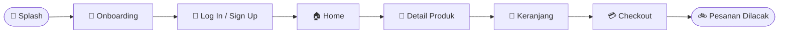
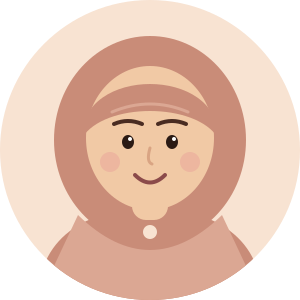

<!-- ========================================= -->
<!-- CRUMELLA - PORTFOLIO TIM                  -->
<!-- Palette: Peach F5CFB3 > Rose B87A6E > Maroon 5C171B -->
<!-- ========================================= -->

 

  

  

---

<h2 align="center">📖 Tentang Crumella</h2>

  Banyak orang ingin menikmati <b>kue, pastry, dan camilan manis</b> yang segar, 
  tetapi repot harus datang langsung ke toko atau bingung memilih.  
  <b>Crumella</b> adalah aplikasi pemesanan dessert berbasis mobile. 
  Pilih dessert, dapatkan penawaran manis, lalu pantau pesananmu sampai ke depan pintu. 🧁

---

<h2 align="center">✨ Fitur Utama</h2>

<table align="center">
  <tr>
    <td align="center" width="180">🔐 <b>Akun Pengguna</b> Log in dan sign up</td>
    <td align="center" width="180">🍰 <b>Menu Dessert</b> Jelajahi semua dessert</td>
    <td align="center" width="180">🔍 <b>Cari dan Kategori</b> Temukan favoritmu cepat</td>
  </tr>
  <tr>
    <td align="center" width="180">🛒 <b>Keranjang</b> Subtotal, ongkir, total</td>
    <td align="center" width="180">💳 <b>Checkout</b> Alamat dan pembayaran</td>
    <td align="center" width="180">🚲 <b>Lacak Pesanan</b> Dari dapur ke pintu</td>
  </tr>
</table>

---

<h2 align="center">🔄 Alur Pemesanan</h2>

---

  

<h2 align="center">👥 Tim Kami</h2>

<table align="center">
  <tr>
    <td align="center" width="260">
      
      <h3>Raisa Salsabilla</h3>
        
      
    </td>
    <td align="center" width="260">
      
      <h3>Faradilatul Najwa</h3>
        
      
    </td>
  </tr>
  <tr>
    <td align="center" width="260">
      
      <h3>Yuwan Shabrina</h3>
        
      
    </td>
    <td align="center" width="260">
      
      <h3>Audiva Shavina</h3>
        
      
    </td>
  </tr>
</table>

  Program Studi Informatika · Fakultas Sains dan Teknologi · Universitas Samudra

---

<h2 align="center">📱 Layar Aplikasi</h2>

| 🧁 Screen | 🍒 Highlight |
|:---|:---|
| **Splash** | Crumella · Sweet Moments, Better Days |
| **Onboarding** | Choose your dessert! · Get a sweet offer! · Track your treat! |
| **Log In / Sign Up** | Email atau username, password, Facebook dan Google |
| **Home** | Search · Categories · Popular Menu |
| **Menu** | Explore our menu, something sweet is waiting for you |
| **Product Detail** | Cloudy Choco Melt · Rp 20.000 · ⭐ 4.8 (120 Review) · Reguler / Large |
| **Cart** | Your sweet cart · Subtotal · Delivery · Total |
| **Checkout** | Shipping Address · Payment Method · Order Summary |
| **Profile** | Hi, Sweetie · Favourites · Language · Location · Subscription |
| **Edit Profile** | Name · E-mail · User Name · Password · Phone number |

---

<h2 align="center">🎨 Sweet Palette</h2>

---

<h2 align="center">🧺 Design Toolkit</h2>

---

| Tahap | Target | Status |
|-------|--------|--------|
| **Tahap 1** | Riset, palet warna, dan konsep Crumella | ✅ Selesai |
| **Tahap 2** | Desain layar: splash, onboarding, log in, home | ✅ Selesai |
| **Tahap 3** | Desain layar: menu, detail, keranjang, checkout, profil | ✅ Selesai |
| **Tahap 4** | Prototype interaktif dan finalisasi | ⏳ Berikutnya |

---

 

