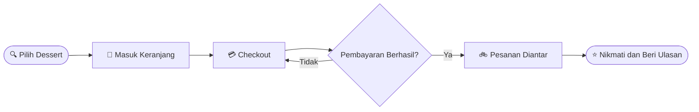

<!-- ========================================= -->
<!-- CRUMELLA - SWEET MOMENTS, BETTER DAYS -->
<!-- Portfolio README                      -->
<!-- Palette: Peach F5CFB3 > Rose B87A6E > Maroon 5C171B -->
<!-- ========================================= -->

  

  

  
  
  
  

  

  
  
  
  
  

---

<h2 align="center">📖 Tentang Crumella</h2>

  Banyak orang ingin menikmati <b>kue, pastry, dan camilan manis</b> yang segar, 
  tetapi sering repot mencari, memilih, dan memesannya.  
  <b>Crumella</b> hadir sebagai aplikasi pemesanan dessert. Cukup dengan beberapa ketukan, 
  dessert favoritmu <b>dibuat segar dan diantar sampai depan pintu</b>. 🧁

---

<h2 align="center">✨ Fitur Utama</h2>

<table align="center">
  <tr>
    <td align="center" width="180">🔐 <b>Akun Pengguna</b> Sign up dan log in mudah</td>
    <td align="center" width="180">🍰 <b>Menu Dessert</b> Jelajahi semua kue dan camilan</td>
    <td align="center" width="180">🔍 <b>Cari dan Kategori</b> Temukan dessert favorit cepat</td>
  </tr>
  <tr>
    <td align="center" width="180">🛒 <b>Keranjang</b> Pilih ukuran Reguler atau Large</td>
    <td align="center" width="180">💳 <b>Checkout</b> Alamat, pembayaran, ringkasan</td>
    <td align="center" width="180">🚲 <b>Lacak Pesanan</b> Pantau dari dapur ke pintu</td>
  </tr>
</table>

---

<h2 align="center">🍒 Sweet Journey</h2>

| 🍰 Step | ✨ Title | 💬 Description |
|:---:|:---:|:---|
| **01** | **Choose your dessert!** | Temukan kue, pastry, dan aneka camilan manis yang dibuat segar setiap hari |
| **02** | **Get a sweet offer!** | Daftar hari ini dan nikmati diskon spesial untuk pesanan dessert pertamamu |
| **03** | **Track your treat!** | Pantau pesananmu dari dapur kami sampai ke depan pintu, tetap segar dan tepat waktu |

---

<h2 align="center">🔄 Alur Pemesanan</h2>

---

<h2 align="center">👥 Tim Kami</h2>

<table align="center">
  <tr>
    <td align="center" width="260">
      
      <h3>Raisa Salsabilla</h3>
        
      
    </td>
    <td align="center" width="260">
      
      <h3>Faradilatul Najwa</h3>
        
      
    </td>
  </tr>
  <tr>
    <td align="center" width="260">
      
      <h3>Yuwan Shabrina</h3>
        
      
    </td>
    <td align="center" width="260">
      
      <h3>Audiva Shavina</h3>
        
      
    </td>
  </tr>
</table>

  Program Studi Informatika · Fakultas Sains dan Teknologi · Universitas Samudra

---

<h2 align="center">📱 Layar Aplikasi</h2>

| 🧁 Layar | 🍒 Highlight |
|:---|:---|
| **Splash** | Crumella · Sweet Moments, Better Days |
| **Onboarding** | Choose your dessert! · Get a sweet offer! · Track your treat! |
| **Log In / Sign Up** | Email atau username, password, Facebook dan Google |
| **Home** | Choose the Dessert you love · Search · Categories · Popular Menu |
| **Menu** | Explore our menu, something sweet is waiting for you |
| **Product Detail** | Cloudy Choco Melt · Rp 20.000 · ⭐ 4.8 (120 Review) · Reguler / Large |
| **Cart** | Your sweet cart · Subtotal · Delivery · Total · Checkout |
| **Checkout** | Shipping Address · Payment Method · Order Summary · Confirmation |
| **Profile** | Hi, Sweetie · Favourites · Language · Location · Subscription |
| **Edit Profile** | Name · E-mail · User Name · Password · Phone number |

---

<h2 align="center">🎨 Sweet Palette</h2>

  
  
  
  
  
  

---

<h2 align="center">🛠️ Teknologi dan Tools</h2>

  

  
  
  

---

  

  <b>Crumella © 2026</b>

  

