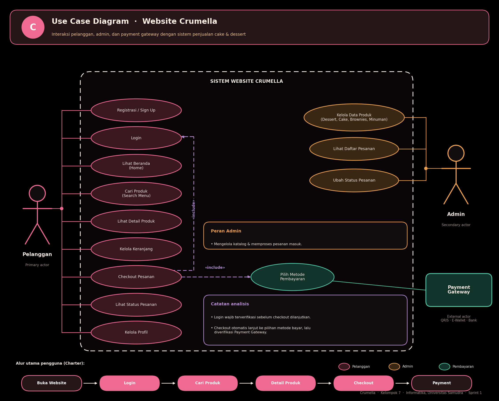

# 📊 Dokumentasi Perancangan Sistem - Crumella

Dokumentasi ini merinci pemodelan sistem fungsional dan struktural dari **Website Penjualan Cake & Dessert Crumella** yang dibangun berdasarkan pendekatan *Object-Oriented Analysis and Design (OOAD)*. Crumella membantu pembeli melihat produk, membaca detail (rasa, harga, tampilan), mengumpulkan pesanan di keranjang, lalu membayarnya sekaligus. Kategori produk yang dilayani: **Dessert, Cake, Brownies, dan Minuman**.

---

## 1. Use Case Diagram (Interaksi Pengguna dengan Sistem)

---

## 👥 A. Identifikasi Aktor (Actors)

Sistem ini melibatkan tiga aktor dengan batas hak akses dan peran yang terdefinisi secara jelas:

*   **Pelanggan (*Primary Actor*)**: Pengguna akhir yang berinteraksi dengan website untuk menjelajahi produk, mengelola keranjang, dan melakukan pemesanan serta pembayaran.
*   **Admin (*Secondary Actor*)**: Pengelola internal toko yang berwenang memperbarui data produk serta memantau dan memproses pesanan yang masuk.
*   **Payment Gateway (*External Actor*)**: Sistem pihak ketiga (menyediakan opsi QRIS, E-Wallet, dan Bank) yang bekerja di latar belakang untuk memverifikasi dan memproses pembayaran.

---

## ⚙️ B. Pembongkaran Fungsionalitas (Use Cases)

Batasan fungsionalitas sistem (*System Boundary*) dikelompokkan berdasarkan hak interaksi masing-masing aktor:

### a. Fitur Spesifik Pelanggan
*   **Registrasi / Sign Up:** Proses pendaftaran bagi pengguna baru agar data akunnya tersimpan di basis data sistem.
*   **Login:** Pintu masuk otentikasi bagi pelanggan terdaftar untuk mengakses fitur transaksi.
*   **Lihat Beranda (Home):** Halaman utama yang menampilkan produk unggulan dan kategori Dessert, Cake, Brownies, serta Minuman.
*   **Cari Produk (Search Menu):** Fitur pencarian agar pelanggan dapat menemukan cake atau dessert favorit tanpa harus menelusuri satu per satu.
*   **Lihat Detail Produk:** Menampilkan informasi lengkap produk, yaitu rasa, harga, deskripsi, dan tampilan gambar.
*   **Kelola Keranjang:** Penampung pesanan sementara, memungkinkan pelanggan menambah, mengurangi, atau menghapus item sebelum dibayar sekaligus.
*   **Checkout Pesanan:** Proses mengubah isi keranjang menjadi pesanan resmi yang siap dibayar.
*   **Lihat Status Pesanan:** Pelanggan memantau tahapan pesanan setelah pembayaran berhasil.
*   **Kelola Profil:** Pelanggan melihat dan memperbarui data akun pribadinya.

### b. Fitur Spesifik Admin
*   **Kelola Data Produk:** Hak eksklusif admin untuk melakukan operasi tambah, ubah, atau hapus (*CRUD*) pada produk Dessert, Cake, Brownies, dan Minuman.
*   **Lihat Daftar Pesanan:** Pemantauan antrean pesanan yang masuk dari pelanggan.
*   **Ubah Status Pesanan:** Otoritas untuk memperbarui tahapan pesanan dari diproses hingga siap diambil atau dikirim.

---

## 🔗 C. Analisis Logika Relasi Pembatas (`<<include>>`)

Kunci utama diagram ini terletak pada dua hubungan dependensi wajib (`<<include>>`) yang mengikat proses transaksi pelanggan:

a.  **Checkout Pesanan `<<include>>` Login**
    *   *Analisis:* Pelanggan boleh menjelajahi produk dan mengisi keranjang, tetapi sebelum `Checkout Pesanan` diproses, sistem wajib memastikan `Login`. Transaksi tidak dapat dilanjutkan jika pelanggan belum terverifikasi.
b.  **Checkout Pesanan `<<include>>` Pilih Metode Pembayaran**
    *   *Analisis:* Setelah checkout tervalidasi, sistem otomatis mengarahkan pelanggan ke `Pilih Metode Pembayaran`. Use case ini menjadi penghubung yang melibatkan aktor **Payment Gateway**.

---

## 🔄 D. Penjelasan Runutan Logika Bisnis (Business Logic Flow)

Alur utama pengguna sesuai charter proyek: **Buka Website → Login → Cari Produk → Detail Produk → Checkout → Payment**. Secara tekstual, interaksi antarkomponen berjalan sebagai berikut:

*   **Fase Penjelajahan:** Pelanggan membuka website, melihat beranda, lalu mencari produk dan membuka detailnya.
*   **Fase Akumulasi:** Produk pilihan dimasukkan ke keranjang dan dapat diubah jumlahnya.
*   **Fase Validasi Transaksi:** Pelanggan menekan checkout, sistem memeriksa status login. Jika valid, alur diteruskan ke pemilihan metode pembayaran.
*   **Fase Penyelesaian & Pemrosesan:** *Payment Gateway* mengesahkan pembayaran. Setelah dana terverifikasi, *Admin* memantau daftar pesanan dan memperbarui statusnya hingga pesanan selesai.

---

## 2. Context Diagram (Batasan & Aliran Data Sistem)

Bagian ini menjelaskan **Diagram Konteks** Website Crumella. Diagram memandang seluruh sistem sebagai satu proses tunggal (*inti pusat*) dan memetakan aliran data masuk (*input*) serta keluar (*output*) dari dan ke entitas luar (*terminator*).

---

## 👥 A. Entitas Luar (External Entities)

Terdapat tiga entitas luar yang bertukar data langsung dengan Sistem Website Crumella:

*   **Pelanggan**: Pembeli cake & dessert yang memberikan data masukan pesanan dan menerima informasi balik dari sistem.
*   **Admin**: Pengelola toko yang menyuplai data produk dan memperbarui progres pesanan.
*   **Payment Gateway**: Penyedia layanan pembayaran (QRIS, E-Wallet, Bank) yang memvalidasi transaksi secara otomatis.

---

## 🔁 B. Aliran Data Masuk ke Sistem (Input Data Flows)

### a. Dari Pelanggan ke Sistem
*   **Data registrasi / login:** Kredensial akun untuk proses otentikasi.
*   **Pilihan produk & keranjang:** Produk yang dipilih dan dimasukkan ke keranjang.
*   **Metode pembayaran:** Jalur pembayaran yang dikehendaki pelanggan.

### b. Dari Admin ke Sistem
*   **Data produk (tambah/ubah/hapus):** Nama, kategori, rasa, harga, deskripsi, dan gambar produk, maupun penghapusan produk.
*   **Perubahan status pesanan:** Pembaruan tahap pengerjaan pesanan.

### c. Dari Payment Gateway ke Sistem
*   **Status pembayaran (berhasil / gagal):** Respon digital yang menyatakan transaksi sah atau dibatalkan.

---

## ↩️ C. Aliran Data Keluar dari Sistem (Output Data Flows)

### a. Dari Sistem ke Pelanggan
*   **Daftar produk, detail & harga:** Katalog terbaru beserta rasa, harga, dan tampilannya.
*   **Konfirmasi & status pesanan:** Nota transaksi dan status pengerjaan pesanan.
*   **Info profil pengguna:** Data akun pelanggan yang dapat dilihat dan diubah.

### b. Dari Sistem ke Admin
*   **Daftar pesanan masuk:** Rincian pesanan baru yang harus segera diproses.
*   **Data produk terkini:** Data produk yang sedang aktif tayang di website.

### c. Dari Sistem ke Payment Gateway
*   **Permintaan pembayaran (metode & total):** Nominal tagihan beserta metode pilihan pelanggan untuk diproses.

---

## 📌 D. Kesimpulan Batasan Sistem (System Boundary)

Sistem Website Crumella bertindak sebagai **jembatan informasi otomatis**. Sistem tidak memproses uang sendiri, melainkan meneruskannya ke *Payment Gateway*. Sistem juga tidak membuat kue secara fisik, melainkan meneruskan datanya sebagai *Daftar pesanan masuk* kepada *Admin* selaku pelaksana operasional.

---

## 3. Sequence Diagram (Alur Proses Checkout & Pembayaran)

Bagian ini menjelaskan **Sequence Diagram** yang menggambarkan interaksi antarobjek dan urutan pesan dalam proses checkout hingga penyelesaian pembayaran di Crumella. Prasyaratnya: pelanggan sudah login dan keranjang berisi produk.

---

## 🏗️ A. Komponen & Objek Sistem (Lifelines)

1.  **Pelanggan**: Aktor yang memulai tindakan dan menerima respon visual.
2.  **Website (Frontend)**: Antarmuka tempat pengguna berinteraksi langsung.
3.  **Backend API**: Pemroses logika bisnis yang menjembatani frontend, database, dan payment gateway.
4.  **Database**: Penyimpanan terpusat untuk data pesanan dan transaksi.
5.  **Payment Gateway**: Pihak ketiga yang memvalidasi transaksi keuangan.

---

## 🔄 B. Kronologi Urutan Alur Utama (Sequential Messages)

1.  **Klik Checkout**: `Pelanggan` menekan tombol checkout di `Website (Frontend)`.
2.  **Tampilkan ringkasan & metode bayar**: `Website` menampilkan ringkasan pesanan dan pilihan cara pembayaran.
3.  **Pilih metode, klik Bayar**: `Pelanggan` memilih metode dan menekan tombol bayar.
4.  **POST /api/pesanan**: `Website` mengirim data pesanan ke `Backend API`.
5.  **INSERT pesanan + detail (menunggu)**: `Backend API` menyimpan pesanan dan rincian itemnya ke `Database` dengan status *menunggu pembayaran*.
6.  **Return id pesanan**: `Database` mengembalikan ID unik pesanan ke `Backend API`.
7.  **Minta pembayaran (total, metode)**: `Backend API` meminta otorisasi ke `Payment Gateway` dengan menyertakan total tagihan dan metode terpilih.
8.  **Status pembayaran**: `Payment Gateway` mengirim hasil transaksi kembali ke `Backend API`.

---

## 🔀 C. Analisis Percabangan Kondisi (Fragment Alt)

Blok kondisi alternatif (**alt**) memisahkan penanganan berdasarkan respon *Payment Gateway*:

### Kondisi A: [pembayaran berhasil]
*   **9. UPDATE status → diproses**: `Backend API` mengubah status pesanan di `Database` dari *menunggu* menjadi *diproses*.
*   **10. Sukses + no pesanan**: `Backend API` mengirim sinyal berhasil beserta nomor pesanan ke `Website`.
*   **11. Tampilkan konfirmasi**: `Website` menampilkan halaman konfirmasi kepada `Pelanggan`.

### Kondisi B: [pembayaran gagal]
*   **12. Respon pembayaran gagal**: `Backend API` meneruskan sinyal kegagalan ke `Website`.
*   **13. Tampilkan pesan gagal & opsi coba lagi**: `Website` menampilkan notifikasi gagal agar pelanggan dapat mencoba kembali.

---

## 4. Class Diagram (Struktur Objek & Basis Data)

Bagian ini menjelaskan **Class Diagram** yang menggambarkan kelas-kelas objek, atribut, metode, serta hubungan antarkomponen data pada basis data Website Crumella.

---

## 🏛️ A. Struktur Kelas Utama dan Atribut (Classes & Attributes)

Sistem ini didukung oleh 8 kelas yang saling terhubung:

*   **User**: Kelas dasar (super-class) abstrak untuk pengguna sistem.
    *   *Atribut:* `id: int`, `nama: String`, `email: String`, `password: String`.
    *   *Metode:* `login()`, `logout()`.
*   **Pelanggan**: Kelas turunan User yang merepresentasikan pembeli.
    *   *Atribut:* `noHp: String`.
    *   *Metode:* `registrasi()`, `lihatBeranda()`, `cariProduk()`, `checkout()`, `lihatStatusPesanan()`, `ubahProfil()`.
*   **Admin**: Kelas turunan User yang merepresentasikan pengelola toko.
    *   *Metode:* `kelolaProduk()`, `lihatDaftarPesanan()`, `ubahStatusPesanan()`.
*   **Keranjang**: Wadah penampung produk sementara milik pelanggan.
    *   *Atribut:* `idKeranjang: int`, `items: List`.
    *   *Metode:* `tambahItem()`, `ubahJumlah()`, `hapusItem()`, `hitungTotal()`.
*   **Produk**: Entitas cake, dessert, brownies, atau minuman yang dijual.
    *   *Atribut:* `id: int`, `namaProduk: String`, `kategori: String` (Dessert / Cake / Brownies / Minuman), `rasa: String`, `harga: int`, `deskripsi: String`, `gambar: String`.
    *   *Metode:* `getDetail()`, `ubahHarga()`.
*   **Pesanan**: Entitas utama yang merekam transaksi pembelian.
    *   *Atribut:* `id: int`, `tanggal: DateTime`, `status: String`, `totalHarga: int`.
    *   *Metode:* `buatPesanan()`, `hitungTotal()`, `ubahStatus()`.
*   **DetailPesanan**: Kelas perantara yang merinci item yang dibeli dalam satu pesanan.
    *   *Atribut:* `id: int`, `jumlah: int`, `subtotal: int`.
    *   *Metode:* `hitungSubtotal()`.
*   **Pembayaran**: Kelas rekaman validasi transaksi keuangan.
    *   *Atribut:* `id: int`, `metode: String`, `jumlahBayar: int`, `status: String`, `waktuBayar: DateTime`.
    *   *Metode:* `prosesPembayaran()`, `cekStatus()`.

---

## 🔗 B. Analisis Hubungan Pewarisan (Generalization / Inheritance)

Relasi pewarisan digambarkan dengan panah segitiga kosong mengarah ke atas:
*   Kelas **User** bertindak sebagai *Parent Class*.
*   Kelas **Pelanggan** dan **Admin** adalah *Child Class* yang mewarisi seluruh atribut dasar (`id`, `nama`, `email`, `password`) serta fungsi `login()` dan `logout()` milik **User**.

---

## 🔀 C. Hubungan Antar-Kelas dan Multiplisitas (Associations & Multiplicity)

*   **Pelanggan dengan Keranjang (`memiliki`)**
    *   *Kardinalitas:* `1` ke `1`.
    *   *Analisis:* Setiap **1** Pelanggan hanya memiliki **1** Keranjang aktif.
*   **Pelanggan dengan Pesanan (`membuat`)**
    *   *Kardinalitas:* `1` ke `1..*`.
    *   *Analisis:* **1** Pelanggan dapat membuat **satu sampai banyak** Pesanan seiring waktu.
*   **Admin dengan Produk (`mengelola`)**
    *   *Kardinalitas:* `1` ke `1..*`.
    *   *Analisis:* **1** Admin berwenang mengelola **satu hingga banyak** Produk.
*   **Pesanan dengan DetailPesanan (`terdiri dari`)**
    *   *Kardinalitas:* `1` ke `1..*`.
    *   *Analisis:* Setiap **1** Pesanan wajib memiliki minimal **1** DetailPesanan.
*   **Produk dengan DetailPesanan (`termasuk dalam`)**
    *   *Kardinalitas:* `1` ke `0..*`.
    *   *Analisis:* Setiap **1** Produk dapat tercatat di **nol atau banyak** DetailPesanan, karena produk baru bisa saja belum pernah dipesan.
*   **Pesanan dengan Pembayaran (`memiliki`)**
    *   *Kardinalitas:* `1` ke `1`.
    *   *Analisis:* Setiap **1** Pesanan dipasangkan dengan tepat **1** catatan Pembayaran untuk memvalidasi dana transaksi.

*Developed with 🍰 by Kelompok 7 - Informatika, Universitas Samudra*
