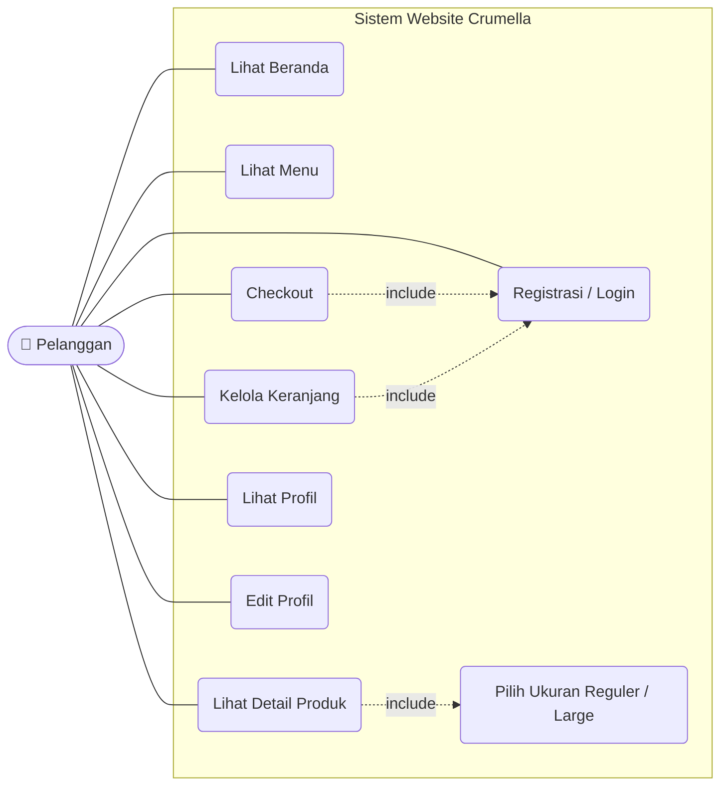

# SPRINT 1 · PERANCANGAN SISTEM

## Analisis sistem *Crumella*

Pemodelan fungsional dan struktural website penjualan cake & dessert dengan pendekatan *Object-Oriented Analysis and Design*: siapa memakai sistem, data apa yang keluar masuk, bagaimana pesanan dibayar, dan objek apa yang tersimpan.

Sweet Moments, Better Days

Kelompok 7

Informatika · Universitas Samudra

Agile / Scrum

Use Case

Context

Sequence

Class

Catatan

### 1 Use Case Diagram Interaksi pengguna dengan sistem

```
graph LR
  subgraph Sistem [SISTEM WEBSITE CRUMELLA]
    UC1[Registrasi / Login]
    UC2[Cari Produk]
    UC3[Lihat Detail Produk]
    UC4[Kelola Keranjang]
    UC5[Checkout Pesanan]
    UC6[Lihat Status Pesanan]
    UC7[Autentikasi]
    UC8[Pilih Ukuran & Jumlah]
    UC9[Pilih Alamat Pengiriman]
    UC10[Pilih Metode Pembayaran]
    UC2 -.->|«extend»| UC3
    UC1 -.->|«include»| UC7
    UC3 -.->|«include»| UC8
    UC5 -.->|«include»| UC9
    UC5 -.->|«include»| UC10
  end
  Pelanggan[Pelanggan] --- UC1
  Pelanggan --- UC2
  Pelanggan --- UC3
  Pelanggan --- UC4
  Pelanggan --- UC5
  Pelanggan --- UC6
```

A UML use case diagram showing interactions between a customer (Pelanggan) and various system use cases of the Crumella website, including include and extend relationships.

UML diagram: UML use case diagram for the Crumella website system.


Screenshot of a mobile application interface showing a menu with eight buttons: 'Kelola Favorit', 'Kelola Profil', 'Kelola Data Produk', 'Lihat Pesanan Masuk', and 'Ubah Status Pesanan'.

#### **PELANGGAN**

Registrasi atau login, mencari produk di kategori Dessert, Cake, Brownies, dan Minuman, membuka detail produk, mengelola keranjang, checkout, memantau status pesanan, menyimpan favorit, dan mengubah profil.

#### **ADMIN**

Menambah, mengubah, dan menghapus data produk, melihat pesanan yang masuk, lalu memperbarui statusnya dari **Dibayar** ke **Diproses** sampai **Selesai**. Admin masuk lewat fungsi Login yang sama.

#### **PAYMENT GATEWAY**

Pada Sprint 1 pembayaran masih simulasi (*dummy*) sesuai dokumen arsitektur, jadi aktor ini hanya mengembalikan status berhasil atau gagal.

**Relasi wajib.** Login selalu melewati Autentikasi. Detail Produk selalu meminta ukuran (Reguler atau Large) dan jumlah. Checkout selalu meminta alamat pengiriman dan metode pembayaran.

### 2 Context Diagram Batasan dan aliran data sistem


Flowchart diagram showing the flow of data into the system. A horizontal orange line with arrows points from the left and right towards a central dark red circle. The left arrow is labeled 'Data login / registrasi, kata kunci, isi keranjang, alamat, metode bayar' and the right arrow is labeled 'Data produk baru, perubahan status pesanan'. The central circle contains the text 'X1. it'.


Pelanggan  
pembeli  
Website  
Crumella  
Daftar produk, detail & harga,  
ringkasan biaya, status pesanan  
Rekap pesanan masuk  
Permintaan bayar  
(total, metode)  
Status transaksi  
(berhasil / gagal)  
Payment Gateway  
simulasi (Sprint 1)  
Website Crumella sebagai satu proses tunggal. Panah oranye adalah data yang dikembalikan sistem.

```
graph TD
    A["Pelanggan<br>pembeli"] <-->|Daftar produk, detail & harga,<br>ringkasan biaya, status pesanan| B["Website<br>Crumella"]
    B <-->|Rekap pesanan masuk| C["Payment Gateway<br>simulasi (Sprint 1)"]
    B -->|Permintaan bayar<br>(total, metode)| C
    C -->|Status transaksi<br>(berhasil / gagal)| B
```

A system interaction diagram showing data flows between a customer (Pelanggan), the Crumella website, and a Payment Gateway, with descriptive text for each directional arrow.

Flowchart: System interaction diagram between customer, Crumella website, and payment gateway.

#### Pelanggan $\rightleftharpoons$ Sistem

Pelanggan mengirim data login, kata kunci, isi keranjang, alamat, dan metode bayar. Sistem membalas dengan daftar produk, harga, ringkasan biaya (subtotal, delivery, total), dan status pesanan.

#### Admin $\rightleftharpoons$ Sistem

Admin mengirim pembaruan produk dan perubahan status pesanan, lalu menerima rekap pesanan yang masuk.

#### Sistem $\rightleftharpoons$ Payment Gateway

Sistem meminta pembayaran dengan total dan metode, lalu menerima status transaksi untuk diteruskan ke pelanggan.

### 3 Sequence Diagram Alur checkout dan pembayaran


```
sequenceDiagram
    participant Pelanggan
    participant Website
    participant Backend API
    participant Database
    participant Pay
    Pelanggan->>Website: 1 Tekan Checkout
    Website-->>Pelanggan: 2 Tampil alamat & metode
    Pelanggan->>Website: 3 Pilih & Confirmation
    Website->>Backend API: 4 POST /api/pesanan
    Backend API->>Database: 5 Simpan pesanan
    Database-->>Backend API: 6 ID pesanan
    Backend API->>Pay: 7 Permintaan bayar (total, metode)
```

A sequence diagram showing the interaction between Pelanggan, Website, Backend API, Database, and Pay during a checkout process, with numbered steps from 1 to 7.

UML diagram: Sequence diagram of an e-commerce checkout process.


ALT · PEMBAYARAN BERHASIL  
8 Status berhasil  
9 Status = dibayar  
10 Data konfirmasi  
11 Order Confirmed + nomor  
ELSE · PEMBAYARAN GAGAL  
12 Status gagal  
13 Status = batal  
14 Pesan error  
15 Tampil error pembayaran  
Garis putus-putus adalah balasan. Bidang hijau dan merah memisahkan dua kemungkinan hasil  
pembayaran.

```
sequenceDiagram
    participant A
    participant B
    participant C
    alt Pembayaran Berhasil
        C->>B: 8 Status berhasil
        B->>C: 9 Status = dibayar
        C-->>A: 10 Data konfirmasi
        A-->>C: 11 Order Confirmed + nomor
    else Pembayaran Gagal
        C-->>B: 12 Status gagal
        B->>C: 13 Status = batal
        C-->>A: 14 Pesan error
        A-->>C: 15 Tampil error pembayaran
    end
```

A UML sequence diagram divided into two alternative scenarios: successful payment (green background) and failed payment (red background), showing message exchanges between three participants.

UML diagram: Sequence diagram of payment success and failure scenarios.

Garis putus-putus adalah balasan. Bidang hijau dan merah memisahkan dua kemungkinan hasil pembayaran.

- |           |                                                                                                         |           |                                                                                  |
|-----------|---------------------------------------------------------------------------------------------------------|-----------|----------------------------------------------------------------------------------|
| <b>1</b>  | Pelanggan menekan <b>Checkout</b> di halaman Cart.                                                      | <b>2</b>  | Website menampilkan alamat pengiriman, metode pembayaran, dan ringkasan pesanan. |
| <b>3</b>  | Setelah memilih alamat dan metode, pelanggan menekan <b>Confirmation</b>.                               | <b>4</b>  | Website mengirim <code>POST /api/pesanan</code> ke Backend API.                  |
| <b>5</b>  | Backend menyimpan pesanan dan detail item dengan status <i>menunggu</i>.                                | <b>6</b>  | Database mengembalikan ID pesanan.                                               |
| <b>7</b>  | Backend meminta pembayaran ke Payment Gateway (simulasi).                                               | <b>8</b>  | <b>Berhasil.</b> Gateway mengirim status berhasil.                               |
| <b>9</b>  | Status pesanan diubah menjadi <i>dibayar</i>.                                                           | <b>10</b> | Backend mengirim data konfirmasi ke Website.                                     |
| <b>11</b> | Pelanggan melihat halaman <b>Order Confirmed</b> dengan nomor pesanan, misalnya <code>#CRM-0012</code>. | <b>12</b> | <b>Gagal.</b> Gateway mengirim status gagal.                                     |
| <b>13</b> | Status pesanan diubah menjadi <i>batal</i>.                                                             | <b>14</b> | Backend mengirim pesan error ke Website.                                         |
| <b>15</b> | Pelanggan melihat pesan error pembayaran.                                                               |           |                                                                                  |

#### 🔗 Class Diagram

### 4 Struktur objek dan basis data


```
classDiagram
    class User {
        id
        nama
        email
        username
        password
        noTelepon
    }
    class Admin {
        kelolaProduk()
        lihatPesananMasuk()
        ubahStatusPesanan()
    }
    class Produk {
        id
        nama
        deskripsi
        harga
        rating
        tersedia
    }
    class Keranjang {
        id
        hitungSubtotal()
    }
    class Item {
        ukuran
        jumlah
    }
    class Pelanggan {
        registrasi()
        editProfil()
        buatPesanan()
    }
    class Alamat {
        id
        label
        alamatLengkap
    }
    class Pesanan {
        noPesanan
        tanggal
        subtotal
        biayaDelivery
        total
        status
    }
    class DetailPesanan {
        ukuran
        jumlah
        hargaSatuan
    }
    class Pembayaran {
        metode
        jumlahBayar
        waktu
        status
    }
    class K

    Admin --|> User
    Pelanggan --|> User
    Pelanggan .. "favorit" --> Produk
    Pelanggan "memiliki" --> Keranjang
    Pelanggan "menyimpan" --> Alamat
    Pelanggan "membuat" --> Pesanan
    Keranjang -- "berisi" --> Item
    Keranjang -- "merujuk" --> Produk
    Item -- "merujuk" --> Produk
    Alamat "dikirim ke" --> Pesanan
    Pesanan -- "memuat" --> DetailPesanan
    Pesanan -- "dibayar via" --> Pembayaran
```

A UML class diagram showing relationships, inheritance, and associations between classes such as User, Admin, Pelanggan, Produk, Keranjang, Pesanan, and others.

UML diagram: UML class diagram of an e-commerce system in Indonesian.

Kotak gelap adalah kelas turunan. Segitiga kosong menunjuk ke kelas induk, garis putus-putus adalah relasi favorit.

#### Pewarisan

User diturunkan menjadi Pelanggan dan Admin . Keduanya mewarisi id, nama, email, username, password, dan noTelepon, sesuai kolom di halaman Edit Profil.

#### Katalog

- Satu Kategori memiliki banyak Produk .
- Admin mengelola Produk .
- Pelanggan dapat menandai banyak produk sebagai favorit.

#### Transaksi

- Pelanggan punya satu Keranjang berisi banyak ItemKeranjang (produk, ukuran,

jumlah).

- Satu Pesan memuat beberapa DetailPesan , dikirim ke satu Alamat , dan dibayar lewat satu Pembayaran .

**Total pesanan** = subtotal + biayaDelivery. Contoh dari desain: Rp 107.000 + Rp 15.000 = Rp 122.000.

### 5 Catatan penyelarasan Hal yang masih perlu diputuskan tim

#### Peran Admin

Charter dan wireframe berfokus pada pembeli. Admin tetap dimodelkan karena produk dan status pesanan perlu dikelola. Tim perlu memastikan halaman Admin masuk Sprint berikutnya.

#### Status pesanan

Menunggu, dibayar, diproses, selesai. Pesanan menjadi batal bila pembayaran gagal. Status yang sama dipakai di halaman Riwayat Pesanan.

#### Fitur di luar Charter

Login Facebook/Google, rating dan review, serta diskon pesanan pertama muncul di desain tetapi belum dimodelkan. Atribut rating dan relasi favorit sudah disiapkan.


