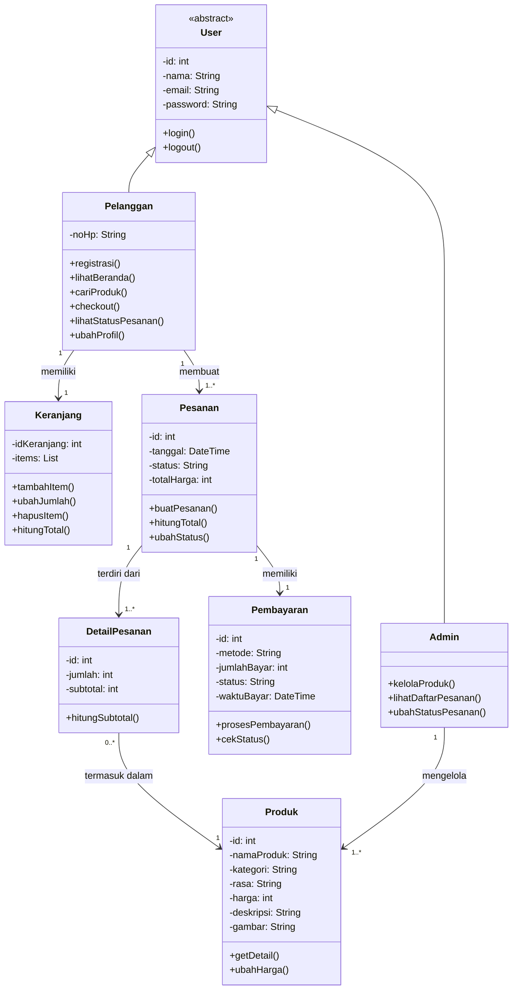

# CLASS DIAGRAM
## Website Crumella

## 1. Tujuan

Class Diagram digunakan untuk menggambarkan struktur kelas, atribut, metode, serta relasi antar-class pada basis data penjualan cake & dessert di website Crumella.

## 2. Class yang Digunakan

Class yang digunakan dalam sistem Crumella terdiri dari:

1. **User** *(abstract)* — class induk yang menyimpan data akun dan fungsi login/logout.
2. **Pelanggan** — pengguna yang berbelanja di website Crumella.
3. **Admin** — pengguna yang mengelola produk dan pesanan.
4. **Keranjang** — menyimpan item yang dipilih Pelanggan sebelum checkout.
5. **Pesanan** — menyimpan data pesanan setelah proses checkout.
6. **DetailPesanan** — menyimpan rincian produk dalam sebuah pesanan.
7. **Pembayaran** — menyimpan data pembayaran dari sebuah pesanan.
8. **Produk** — menyimpan informasi produk cake & dessert.

## 3. Class Diagram

## 4. Penjelasan Class

### User
Class User adalah class abstrak yang menyimpan atribut umum akun (id, nama, email, password) serta method login dan logout. Class ini tidak dibuat objeknya secara langsung, melainkan diwariskan ke Pelanggan dan Admin.

### Pelanggan
Class Pelanggan mewarisi User dan menambahkan atribut noHp. Pelanggan dapat melakukan registrasi, melihat beranda, mencari produk, checkout, melihat status pesanan, dan mengubah profil.

### Admin
Class Admin mewarisi seluruh atribut User tanpa atribut tambahan. Admin bertugas mengelola produk, melihat daftar pesanan, dan mengubah status pesanan.

### Keranjang
Class Keranjang menyimpan item yang dipilih Pelanggan sebelum checkout. Pelanggan dapat menambah item, mengubah jumlah, menghapus item, dan menghitung total.

### Pesanan
Class Pesanan menyimpan data pesanan yang dibuat Pelanggan melalui checkout, yaitu id, tanggal, status, dan total harga.

### DetailPesanan
Class DetailPesanan menyimpan rincian setiap produk dalam sebuah pesanan, meliputi jumlah dan subtotal.

### Pembayaran
Class Pembayaran menyimpan data pembayaran sebuah pesanan, yaitu metode, jumlah bayar, status, dan waktu bayar.

### Produk
Class Produk menyimpan informasi produk yang dijual, yaitu nama, kategori (Dessert, Cake, Brownies, Minuman), rasa, harga, deskripsi, dan gambar.

## 5. Relasi Antar-Class

| Relasi | Keterangan |
|---|---|
| User → Pelanggan & Admin | Generalization: Pelanggan dan Admin mewarisi atribut serta method User |
| Pelanggan → Keranjang | Satu Pelanggan memiliki satu Keranjang (1 : 1) |
| Pelanggan → Pesanan | Satu Pelanggan dapat membuat satu atau banyak Pesanan (1 : 1..*) |
| Pesanan → Pembayaran | Satu Pesanan memiliki satu Pembayaran (1 : 1) |
| Pesanan → DetailPesanan | Satu Pesanan terdiri dari satu atau banyak DetailPesanan (1 : 1..*) |
| DetailPesanan → Produk | Setiap DetailPesanan mengacu pada satu Produk, dan satu Produk dapat masuk ke nol atau banyak DetailPesanan (0..* : 1) |
| Admin → Produk | Satu Admin mengelola satu atau banyak Produk (1 : 1..*) |

**Kardinalitas:** `1` = tepat satu · `0..*` = nol atau banyak · `1..*` = satu atau banyak

## 6. Kesimpulan

Class Diagram Crumella menggambarkan struktur data utama yang mendukung proses registrasi dan login, pencarian produk, pengelolaan keranjang, checkout, pembayaran, pemantauan status pesanan oleh Pelanggan, serta pengelolaan produk dan pesanan oleh Admin.
