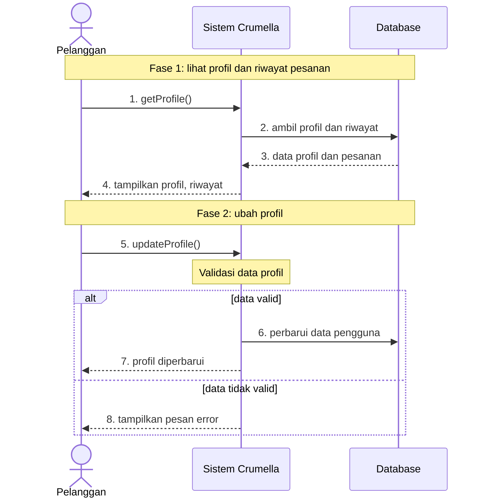
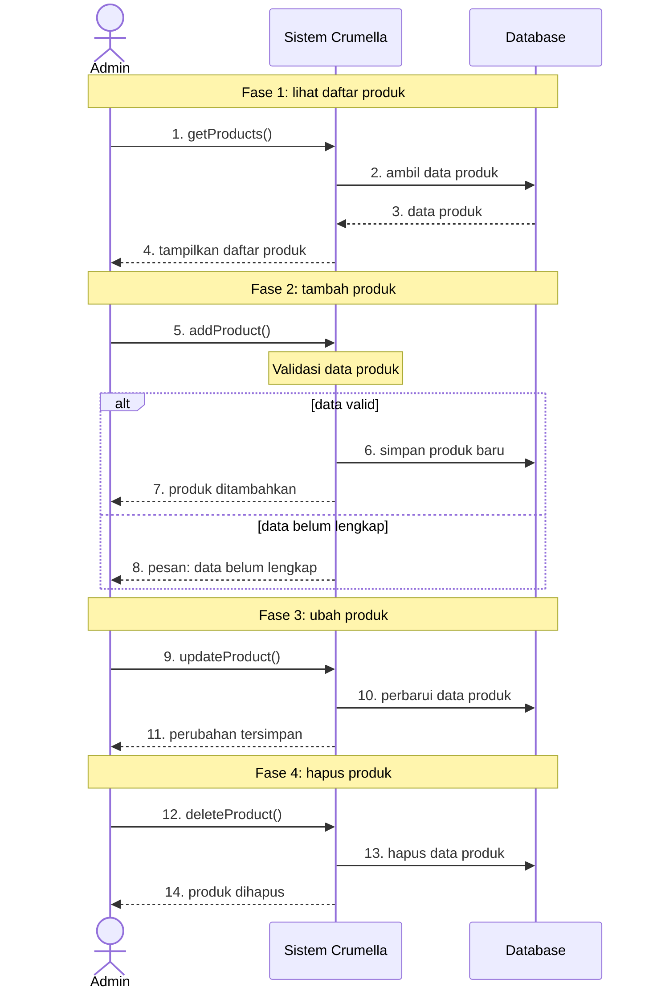
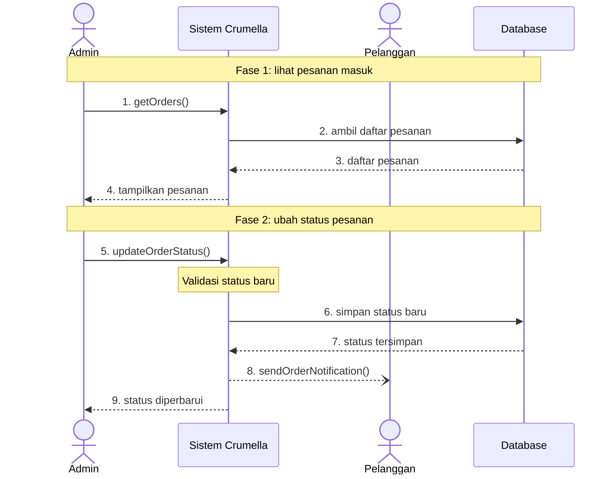
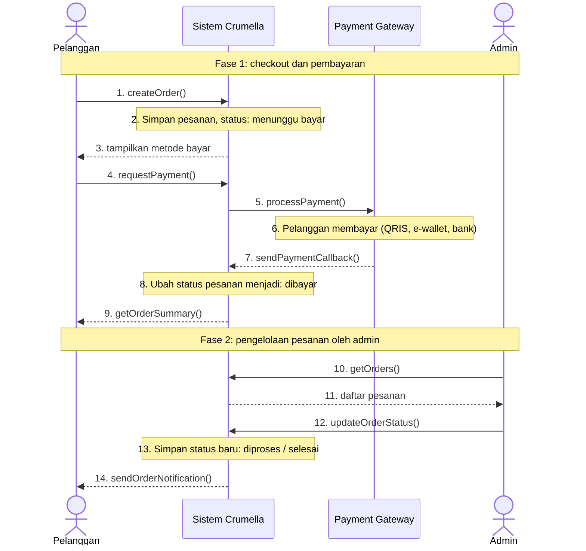

# PENJELASAN SEQUENCE DIAGRAM
## Crumella

## 1. Pendahuluan

Sequence Diagram menggambarkan **pertukaran pesan antarobjek berdasarkan urutan waktu**. Yang ditampilkan adalah siapa mengirim pesan kepada siapa, operasi apa yang dipanggil, dan balasan apa yang dikembalikan.

Pada proyek Crumella, diagram dibuat dengan pola sederhana: **Aktor - Sistem Crumella - Database**, ditambah **Payment Gateway** pada fitur pembayaran.

| Objek | Peran |
|---|---|
| Pelanggan | Pihak yang mendaftar, login, mencari produk, berbelanja, membayar, dan mengelola profil |
| Admin | Pihak yang mengelola produk dan pesanan |
| Sistem Crumella | Menerima permintaan, melakukan validasi, memproses data, dan mengirim balasan |
| Database | Menyimpan dan mengembalikan data |
| Payment Gateway | Layanan pihak ketiga yang memproses pembayaran (QRIS, e-wallet, bank) |

## 2. Tujuan Sequence Diagram

1. Menunjukkan pesan dan balasan antarobjek pada setiap fitur.
2. Menunjukkan pembagian tugas antara Pelanggan, Admin, Sistem Crumella, Database, dan Payment Gateway.
3. Menjadi acuan penamaan fungsi dan pengujian alur sistem.

## 3. Daftar Diagram

| No | Diagram | Aktor | Fase |
|---|---|---|---|
| 1 | Autentikasi | Pelanggan | Registrasi, login, logout |
| 2 | Pencarian, Detail Produk, dan Keranjang | Pelanggan | Cari produk, lihat detail, tambah ke keranjang |
| 3 | Profil Pelanggan | Pelanggan | Lihat profil dan riwayat pesanan, ubah profil |
| 4 | Kelola Produk | Admin | Lihat, tambah, ubah, hapus produk |
| 5 | Kelola Pesanan | Admin, Pelanggan | Lihat pesanan masuk, ubah status pesanan |
| 6 | Checkout dan Pembayaran | Pelanggan, Payment Gateway, Admin | Checkout dan pembayaran, pengelolaan pesanan oleh admin |

## 4. Keterangan Notasi

| Notasi | Arti |
|---|---|
| Panah penuh | Permintaan (pemanggilan operasi) |
| Panah putus-putus | Balasan atau hasil yang dikembalikan |
| Panah putus-putus dengan ujung terbuka | Notifikasi satu arah |
| Kotak di lifeline | Pemrosesan internal sistem (misalnya validasi) |
| `alt` | Dua kemungkinan alur yang saling menggantikan |
| Nomor pada panah | Urutan pesan |
| Fase | Pengelompokan langkah berdasarkan tahap proses |

---

# 5. Sequence Diagram Autentikasi

## Pengertian

Menggambarkan tiga fase autentikasi pelanggan: registrasi akun baru, login dengan verifikasi password, dan logout.

## Diagram

## Penjelasan Interaksi

| No | Fase | Dari | Ke | Pesan | Jenis |
|---|---|---|---|---|---|
| 1 | Registrasi | Pelanggan | Sistem Crumella | `register()` | Permintaan |
| 2 | Registrasi | Sistem Crumella | Database | `cari email` | Permintaan |
| 3 | Registrasi | Database | Sistem Crumella | `hasil pencarian` | Balasan |
| 4 | Registrasi | Sistem Crumella | Database | `simpan data pengguna` | Permintaan |
| 5 | Registrasi | Sistem Crumella | Pelanggan | `akun berhasil dibuat` | Balasan |
| 6 | Registrasi | Sistem Crumella | Pelanggan | `pesan: email terdaftar` | Balasan |
| 7 | Login | Pelanggan | Sistem Crumella | `login()` | Permintaan |
| 8 | Login | Sistem Crumella | Database | `ambil data pengguna` | Permintaan |
| 9 | Login | Database | Sistem Crumella | `data pengguna` | Balasan |
| - | Login | Sistem Crumella | Sistem Crumella | `Verifikasi password` | Internal |
| 10 | Login | Sistem Crumella | Pelanggan | `buat sesi, buka Home` | Balasan |
| 11 | Login | Sistem Crumella | Pelanggan | `tampilkan pesan error` | Balasan |
| 12 | Logout | Pelanggan | Sistem Crumella | `logout()` | Permintaan |
| - | Logout | Sistem Crumella | Sistem Crumella | `Hapus sesi pengguna` | Internal |
| 13 | Logout | Sistem Crumella | Pelanggan | `kembali ke halaman login` | Balasan |

**Catatan:** Pesan 5 dan 6 saling menggantikan (`alt` email), begitu juga pesan 10 dan 11 (`alt` password). Pada logout, Database tidak terlibat karena hanya sesi yang dihapus.

---

# 6. Sequence Diagram Pencarian, Detail Produk, dan Keranjang

## Pengertian

Menggambarkan tiga fase belanja pelanggan: mencari produk dengan filter, melihat detail produk, dan menambahkan produk ke keranjang.

## Diagram

## Penjelasan Interaksi

| No | Fase | Dari | Ke | Pesan | Jenis |
|---|---|---|---|---|---|
| 1 | Cari produk | Pelanggan | Sistem Crumella | `searchProduct()` | Permintaan |
| 2 | Cari produk | Sistem Crumella | Database | `cari sesuai filter` | Permintaan |
| 3 | Cari produk | Database | Sistem Crumella | `hasil pencarian` | Balasan |
| 4 | Cari produk | Sistem Crumella | Pelanggan | `tampilkan hasil` | Balasan |
| 5 | Detail produk | Pelanggan | Sistem Crumella | `getProductDetail()` | Permintaan |
| 6 | Detail produk | Sistem Crumella | Database | `ambil detail produk` | Permintaan |
| 7 | Detail produk | Database | Sistem Crumella | `data produk` | Balasan |
| 8 | Detail produk | Sistem Crumella | Pelanggan | `tampilkan foto, rasa, harga` | Balasan |
| 9 | Keranjang | Pelanggan | Sistem Crumella | `addToCart()` | Permintaan |
| 10 | Keranjang | Sistem Crumella | Database | `simpan ke keranjang` | Permintaan |
| 11 | Keranjang | Sistem Crumella | Pelanggan | `keranjang diperbarui` | Balasan |

**Catatan:** Detail produk yang ditampilkan mencakup foto, rasa, dan harga. Ketiga fase memakai lifeline yang sama sehingga terlihat bahwa seluruh proses ditangani objek yang sama.

---

# 7. Sequence Diagram Profil Pelanggan

## Pengertian

Menggambarkan dua fase pada profil: menampilkan profil beserta riwayat pesanan, lalu mengubah data profil dengan validasi.

## Diagram

## Penjelasan Interaksi

| No | Fase | Dari | Ke | Pesan | Jenis |
|---|---|---|---|---|---|
| 1 | Lihat profil | Pelanggan | Sistem Crumella | `getProfile()` | Permintaan |
| 2 | Lihat profil | Sistem Crumella | Database | `ambil profil dan riwayat` | Permintaan |
| 3 | Lihat profil | Database | Sistem Crumella | `data profil dan pesanan` | Balasan |
| 4 | Lihat profil | Sistem Crumella | Pelanggan | `tampilkan profil, riwayat` | Balasan |
| 5 | Ubah profil | Pelanggan | Sistem Crumella | `updateProfile()` | Permintaan |
| - | Ubah profil | Sistem Crumella | Sistem Crumella | `Validasi data profil` | Internal |
| 6 | Ubah profil | Sistem Crumella | Database | `perbarui data pengguna` | Permintaan |
| 7 | Ubah profil | Sistem Crumella | Pelanggan | `profil diperbarui` | Balasan |
| 8 | Ubah profil | Sistem Crumella | Pelanggan | `tampilkan pesan error` | Balasan |

**Catatan:** Data hanya disimpan ke Database jika validasi berhasil. Jika tidak valid, pelanggan langsung menerima pesan error (pesan 8) tanpa akses ke Database.

---

# 8. Sequence Diagram Kelola Produk (Admin)

## Pengertian

Menggambarkan empat fase pengelolaan produk oleh admin: melihat daftar, menambah, mengubah, dan menghapus produk.

## Diagram

## Penjelasan Interaksi

| No | Fase | Dari | Ke | Pesan | Jenis |
|---|---|---|---|---|---|
| 1 | Lihat daftar | Admin | Sistem Crumella | `getProducts()` | Permintaan |
| 2 | Lihat daftar | Sistem Crumella | Database | `ambil data produk` | Permintaan |
| 3 | Lihat daftar | Database | Sistem Crumella | `data produk` | Balasan |
| 4 | Lihat daftar | Sistem Crumella | Admin | `tampilkan daftar produk` | Balasan |
| 5 | Tambah produk | Admin | Sistem Crumella | `addProduct()` | Permintaan |
| - | Tambah produk | Sistem Crumella | Sistem Crumella | `Validasi data produk` | Internal |
| 6 | Tambah produk | Sistem Crumella | Database | `simpan produk baru` | Permintaan |
| 7 | Tambah produk | Sistem Crumella | Admin | `produk ditambahkan` | Balasan |
| 8 | Tambah produk | Sistem Crumella | Admin | `pesan: data belum lengkap` | Balasan |
| 9 | Ubah produk | Admin | Sistem Crumella | `updateProduct()` | Permintaan |
| 10 | Ubah produk | Sistem Crumella | Database | `perbarui data produk` | Permintaan |
| 11 | Ubah produk | Sistem Crumella | Admin | `perubahan tersimpan` | Balasan |
| 12 | Hapus produk | Admin | Sistem Crumella | `deleteProduct()` | Permintaan |
| 13 | Hapus produk | Sistem Crumella | Database | `hapus data produk` | Permintaan |
| 14 | Hapus produk | Sistem Crumella | Admin | `produk dihapus` | Balasan |

**Catatan:** Hanya fase tambah produk yang memiliki percabangan `alt`: pesan 7 dan 8 saling menggantikan sesuai hasil validasi kelengkapan data.

---

# 9. Sequence Diagram Kelola Pesanan (Admin)

## Pengertian

Menggambarkan dua fase pengelolaan pesanan: admin melihat pesanan masuk, lalu mengubah statusnya. Setelah status berubah, pelanggan menerima notifikasi.

## Diagram

## Penjelasan Interaksi

| No | Fase | Dari | Ke | Pesan | Jenis |
|---|---|---|---|---|---|
| 1 | Lihat pesanan | Admin | Sistem Crumella | `getOrders()` | Permintaan |
| 2 | Lihat pesanan | Sistem Crumella | Database | `ambil daftar pesanan` | Permintaan |
| 3 | Lihat pesanan | Database | Sistem Crumella | `daftar pesanan` | Balasan |
| 4 | Lihat pesanan | Sistem Crumella | Admin | `tampilkan pesanan` | Balasan |
| 5 | Ubah status | Admin | Sistem Crumella | `updateOrderStatus()` | Permintaan |
| - | Ubah status | Sistem Crumella | Sistem Crumella | `Validasi status baru` | Internal |
| 6 | Ubah status | Sistem Crumella | Database | `simpan status baru` | Permintaan |
| 7 | Ubah status | Database | Sistem Crumella | `status tersimpan` | Balasan |
| 8 | Ubah status | Sistem Crumella | Pelanggan | `sendOrderNotification()` | Notifikasi |
| 9 | Ubah status | Sistem Crumella | Admin | `status diperbarui` | Balasan |

**Catatan:** Notifikasi ke pelanggan (pesan 8) dikirim setelah status tersimpan di Database, dan tidak menunggu balasan dari pelanggan.

---

# 10. Sequence Diagram Checkout dan Pembayaran

## Pengertian

Menggambarkan dua fase: pelanggan melakukan checkout dan pembayaran melalui Payment Gateway, lalu admin mengelola pesanan yang sudah masuk hingga pelanggan diberi notifikasi.

## Diagram

## Penjelasan Interaksi

| No | Fase | Dari | Ke | Pesan | Jenis |
|---|---|---|---|---|---|
| 1 | Checkout dan pembayaran | Pelanggan | Sistem Crumella | `createOrder()` | Permintaan |
| 2 | Checkout dan pembayaran | Sistem Crumella | Sistem Crumella | `Simpan pesanan, status: menunggu bayar` | Internal |
| 3 | Checkout dan pembayaran | Sistem Crumella | Pelanggan | `tampilkan metode bayar` | Balasan |
| 4 | Checkout dan pembayaran | Pelanggan | Sistem Crumella | `requestPayment()` | Permintaan |
| 5 | Checkout dan pembayaran | Sistem Crumella | Payment Gateway | `processPayment()` | Permintaan |
| 6 | Checkout dan pembayaran | Payment Gateway | Payment Gateway | `Pelanggan membayar (QRIS, e-wallet, bank)` | Internal |
| 7 | Checkout dan pembayaran | Payment Gateway | Sistem Crumella | `sendPaymentCallback()` | Balasan |
| 8 | Checkout dan pembayaran | Sistem Crumella | Sistem Crumella | `Ubah status pesanan menjadi: dibayar` | Internal |
| 9 | Checkout dan pembayaran | Sistem Crumella | Pelanggan | `getOrderSummary()` | Balasan |
| 10 | Pengelolaan pesanan | Admin | Sistem Crumella | `getOrders()` | Permintaan |
| 11 | Pengelolaan pesanan | Sistem Crumella | Admin | `daftar pesanan` | Balasan |
| 12 | Pengelolaan pesanan | Admin | Sistem Crumella | `updateOrderStatus()` | Permintaan |
| 13 | Pengelolaan pesanan | Sistem Crumella | Sistem Crumella | `Simpan status baru: diproses / selesai` | Internal |
| 14 | Pengelolaan pesanan | Sistem Crumella | Pelanggan | `sendOrderNotification()` | Notifikasi |

**Catatan:** Status pesanan berubah mengikuti alur: *menunggu bayar*, *dibayar*, lalu *diproses / selesai*. Perubahan menjadi *dibayar* terjadi otomatis setelah callback dari Payment Gateway, sedangkan perubahan berikutnya dilakukan manual oleh admin. Pada diagram ini Database tidak digambarkan sebagai lifeline terpisah.

---

# 11. Kesimpulan

Sequence Diagram Crumella menggambarkan pertukaran pesan antara Pelanggan, Admin, Sistem Crumella, Database, dan Payment Gateway. Diagram ini menekankan operasi yang dipanggil dan balasan yang dikembalikan pada setiap fase proses.

Fitur yang tercakup: Registrasi, Login, Logout, Pencarian Produk, Detail Produk, Keranjang, Profil Pelanggan, Kelola Produk (Admin), Kelola Pesanan (Admin), serta Checkout dan Pembayaran melalui Payment Gateway.
