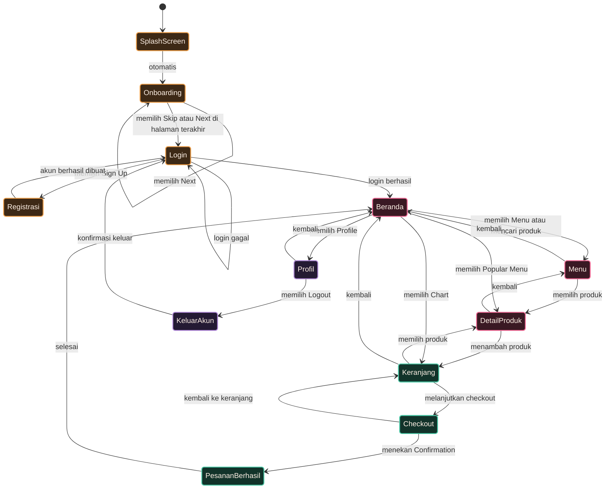

# STATE DIAGRAM
## Crumella

## 1. Tujuan

State Diagram digunakan untuk menggambarkan perubahan keadaan yang terjadi pada sistem berdasarkan aktivitas atau kejadian yang dilakukan Pelanggan.

## 2. State yang Digunakan

State utama pada aplikasi Crumella adalah:

1. Splash Screen
2. Onboarding
3. Login
4. Registrasi
5. Beranda
6. Menu
7. Detail Produk
8. Keranjang
9. Checkout
10. Pesanan Berhasil
11. Profil
12. Keluar Akun

## 3. State Diagram

### Keterangan Warna

| Warna | Kelompok State |
|---|---|
| Oranye | Awal dan autentikasi: Splash Screen, Onboarding, Login, Registrasi |
| Pink | Jelajah produk: Beranda, Menu, Detail Produk |
| Teal | Transaksi: Keranjang, Checkout, Pesanan Berhasil |
| Ungu | Akun: Profil, Keluar Akun |

## 4. Penjelasan State

### Splash Screen
Sistem menampilkan logo Crumella dan tagline "Sweet Moments, Better Days", lalu otomatis menuju Onboarding.

### Onboarding
Pelanggan melihat tiga halaman pengenalan "Explore our menu". Tombol Next berpindah ke halaman berikutnya, sedangkan Skip atau Next di halaman terakhir mengarahkan Pelanggan ke Login.

### Login
Pelanggan memasukkan email atau username dan kata sandi, atau masuk melalui Facebook atau Google. Jika berhasil, sistem mengarahkan Pelanggan ke Beranda. Jika gagal, Pelanggan tetap berada di halaman Login.

### Registrasi
Pelanggan membuat akun baru melalui tab Sign Up. Setelah registrasi berhasil, Pelanggan kembali ke halaman Login.

### Beranda
Pelanggan dapat mencari dessert, melihat kategori dan Popular Menu, serta menuju fitur lainnya melalui navigasi bawah (Home, Menu, Chart, Profile).

### Menu
Pelanggan melihat daftar produk pada halaman "Explore our menu" dan dapat mencari pastries berdasarkan kata kunci.

### Detail Produk
Pelanggan melihat informasi produk seperti foto, nama, harga, rating, deskripsi, pilihan ukuran, dan jumlah, serta dapat menandai produk sebagai favorit. Pelanggan dapat menambahkan produk ke Keranjang.

### Keranjang
Halaman "Your sweet cart" menampilkan produk yang dipilih. Pelanggan dapat melanjutkan ke Checkout.

### Checkout
Pelanggan memilih alamat pengiriman dan metode pembayaran, meninjau ringkasan pesanan, lalu menekan Confirmation.

### Pesanan Berhasil
Sistem menampilkan hasil checkout setelah pesanan berhasil dikonfirmasi.

### Profil
Pelanggan melihat informasi akun (Hi, Sweetie), daftar pengaturan, dan tombol Logout.

### Keluar Akun
Pelanggan melakukan konfirmasi untuk keluar dari sistem dan kembali ke halaman Login.

## 5. Catatan

- Navigasi bawah (Home, Menu, Chart, Profile) memungkinkan perpindahan antar Beranda, Menu, Keranjang, dan Profil. Diagram hanya menggambar jalur utamanya agar tetap mudah dibaca.
- Pesanan Berhasil belum ada pada mockup UI/UX. State ini ditambahkan sebagai hasil dari tombol Confirmation, mengikuti State Diagram sebelumnya.

## 6. Kesimpulan

State Diagram Crumella menggambarkan perubahan keadaan Pelanggan mulai dari Splash Screen dan Onboarding, melakukan registrasi atau login, menjelajahi produk melalui Beranda dan Menu, memasukkan produk ke keranjang, melakukan checkout, melihat profil, hingga keluar dari akun. Diagram ini menunjukkan bagaimana sistem berpindah dari satu keadaan ke keadaan lainnya berdasarkan aktivitas yang dilakukan Pelanggan.
