# PENJELASAN USE CASE DIAGRAM
## Crumella — Cake and Dessert

## 1. Pendahuluan

Use Case Diagram adalah diagram yang menggambarkan siapa saja yang menggunakan sistem dan fitur apa saja yang dapat mereka lakukan.

Pada proyek Crumella, Use Case Diagram digunakan untuk menjelaskan fitur-fitur utama sistem pemesanan cake dan dessert, mulai dari melihat pengenalan aplikasi (onboarding), registrasi dan login, memilih dessert, memesan, hingga keluar dari akun. Seluruh fitur pada dokumen ini disesuaikan dengan **desain Figma (DESIGN_WEB.pdf)** yang terdiri dari 13 layar: Splash, Onboarding (3 layar), Login, Beranda, Menu, Detail Dessert, Keranjang, Checkout, Profil (2 varian), dan Edit Profil.

## 2. Tujuan Use Case Diagram

1. Menggambarkan fitur-fitur yang tersedia pada sistem Crumella.
2. Menunjukkan siapa yang menggunakan setiap fitur.
3. Memastikan fitur yang dibuat sesuai dengan desain Figma dan tidak ada fitur tambahan di luar desain.
4. Mempermudah anggota Kelompok 7 memahami cakupan sistem sebelum tahap pengkodean.
5. Menjadi acuan dalam pengembangan dan pengujian sistem pada Sprint berikutnya.

## 3. Aktor

| Aktor | Jenis | Penjelasan |
|---|---|---|
| Pelanggan | Aktor utama | Pengguna Crumella yang melihat onboarding, mendaftar, login, mencari dan memilih dessert, memesan, mengelola profil, dan keluar akun. |
| Google / Facebook | Aktor pendukung | Layanan pihak ketiga yang membantu proses login. Pada desain terdapat dua tombol ikon (Facebook dan Google) di halaman Login. |

Pada desain Figma tidak terdapat halaman admin, sehingga tidak ada aktor Admin. Aktor Google/Facebook hanya terlibat pada satu use case, yaitu Login dengan Akun Sosial.

## 4. Use Case Diagram Keseluruhan

### Pengertian

Diagram ini menggambarkan seluruh fitur yang dapat dilakukan Pelanggan pada Crumella dalam satu gambar.

### Diagram

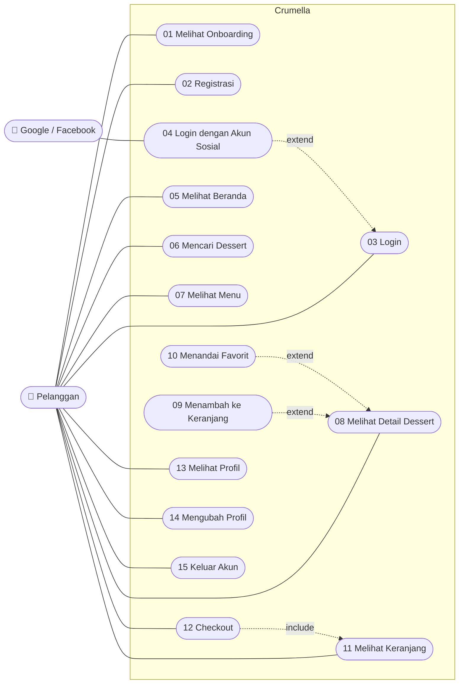

### Cara Membaca Diagram

1. **Pelanggan** adalah aktor utama yang menggunakan Crumella.
2. **Google / Facebook** adalah aktor pendukung yang hanya terhubung ke use case Login dengan Akun Sosial.
3. **Kotak "Crumella"** adalah batas sistem. Semua use case berada di dalamnya.
4. **Oval** adalah satu fitur yang dapat dilakukan.
5. **Garis lurus** berarti aktor melakukan fitur tersebut secara langsung.
6. **Panah putus-putus include** berarti fitur tersebut selalu menjalankan fitur lain.
7. **Panah putus-putus extend** berarti fitur tersebut adalah tambahan yang boleh dilakukan (opsional) dari fitur lain.

## 5. Daftar Use Case

| No | Use Case | Penjelasan Singkat | Layar Desain Figma |
|---|---|---|---|
| 01 | Melihat Onboarding | Melihat 3 layar pengenalan aplikasi | Splash dan Onboarding 1–3 |
| 02 | Registrasi | Membuat akun baru | Login (tab Sign Up) |
| 03 | Login | Masuk dengan email/username dan kata sandi | Login |
| 04 | Login dengan Akun Sosial | Masuk menggunakan akun Google atau Facebook | Login |
| 05 | Melihat Beranda | Melihat kategori dan menu populer | Beranda |
| 06 | Mencari Dessert | Mencari dessert dengan kata kunci | Beranda dan Menu (kolom pencarian) |
| 07 | Melihat Menu | Melihat daftar dessert dalam bentuk grid | Menu |
| 08 | Melihat Detail Dessert | Melihat informasi lengkap satu dessert | Detail Dessert |
| 09 | Menambah ke Keranjang | Memilih ukuran dan jumlah, lalu menambah ke keranjang | Detail Dessert |
| 10 | Menandai Favorit | Menandai dessert dengan ikon hati | Detail Dessert dan Keranjang |
| 11 | Melihat Keranjang | Melihat dessert terpilih dan rincian biaya | Keranjang |
| 12 | Checkout | Memilih alamat, metode pembayaran, dan mengonfirmasi pesanan | Checkout |
| 13 | Melihat Profil | Melihat identitas akun dan menu profil | Profil |
| 14 | Mengubah Profil | Mengubah data akun | Edit Profil |
| 15 | Keluar Akun | Mengakhiri sesi dan kembali ke Login | Profil (Log Out / Logout) |

## 6. Use Case Melihat Onboarding

### Pengertian

Use Case Melihat Onboarding menggambarkan fitur ketika Pelanggan pertama kali membuka Crumella dan melihat layar pengenalan sebelum masuk ke halaman Login.

### Diagram

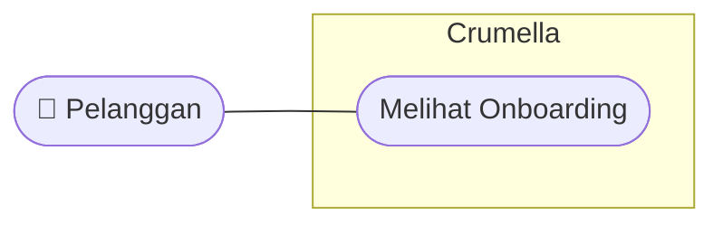

### Deskripsi Use Case

| Bagian | Keterangan |
|---|---|
| Aktor | Pelanggan |
| Prasyarat | Pelanggan baru membuka aplikasi |
| Layar Figma | Splash, Onboarding 1, 2, dan 3 |
| Hasil Akhir | Pelanggan diarahkan ke halaman Login |

### Alur Utama

1. Sistem menampilkan layar Splash berisi logo Crumella dan slogan "Sweet Moments, Better Days".
2. Sistem menampilkan Onboarding 1 ("Choose your dessert!") berisi ajakan memilih kue, pastry, dan camilan manis.
3. Pelanggan menekan **Next** menuju Onboarding 2 ("Get a sweet offer!") berisi penawaran diskon pesanan pertama.
4. Pelanggan menekan **Next** menuju Onboarding 3 ("Track your treat!") berisi informasi pemantauan pesanan.
5. Pelanggan menekan **Next** dan diarahkan ke halaman Login.

### Alur Alternatif

- Pelanggan menekan **Skip** di layar onboarding mana pun: sistem langsung menampilkan halaman Login.

## 7. Use Case Registrasi

### Pengertian

Use Case Registrasi menggambarkan fitur ketika calon pengguna membuat akun baru agar dapat memesan dessert di Crumella.

### Diagram

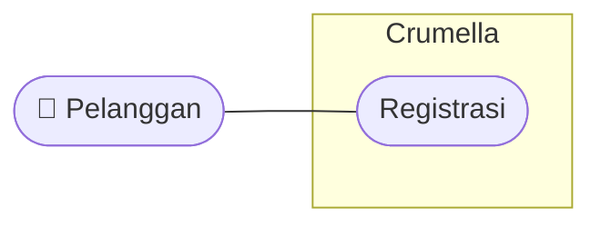

### Deskripsi Use Case

| Bagian | Keterangan |
|---|---|
| Aktor | Pelanggan |
| Prasyarat | Pelanggan belum memiliki akun |
| Layar Figma | Login (tab **Sign Up** atau tautan "Not Registered yet? Sign Up") |
| Hasil Akhir | Akun baru tersimpan dan Pelanggan dapat login |

### Alur Utama

1. Pelanggan membuka halaman Login.
2. Pelanggan menekan tab **Sign Up** atau tautan **Sign Up** di bagian bawah.
3. Pelanggan mengisi data akun (nama, email, username, kata sandi, dan nomor telepon, mengacu pada kolom di halaman Edit Profil).
4. Sistem memvalidasi data dan memeriksa apakah email atau username sudah terdaftar.
5. Sistem menyimpan akun baru dan mengarahkan Pelanggan ke halaman Login.

### Alur Alternatif

- Email atau username sudah terdaftar: sistem menampilkan pesan kesalahan dan akun tidak disimpan.
- Ada kolom yang kosong: sistem meminta Pelanggan melengkapi data.

### Catatan

Tampilan form Sign Up belum digambar di Figma (hanya tab-nya). Kolom yang dipakai pada langkah 3 diambil dari halaman Edit Profil dan perlu dikonfirmasi bersama.

## 8. Use Case Login

### Pengertian

Use Case Login menggambarkan fitur ketika Pelanggan memasukkan email atau username dan kata sandi untuk masuk ke Crumella.

### Diagram

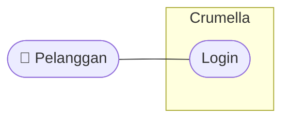

### Deskripsi Use Case

| Bagian | Keterangan |
|---|---|
| Aktor | Pelanggan |
| Prasyarat | Pelanggan sudah memiliki akun |
| Layar Figma | Login (tab **Log In**) |
| Hasil Akhir | Pelanggan masuk ke sistem dan melihat Beranda |

### Alur Utama

1. Pelanggan membuka halaman Login.
2. Pelanggan mengisi kolom **Enter Email Or Username** dan **Password**.
3. Pelanggan dapat menekan ikon mata untuk menampilkan atau menyembunyikan kata sandi.
4. Pelanggan menekan tombol **Log In**.
5. Sistem memeriksa data akun melalui database.
6. Sistem mengarahkan Pelanggan ke halaman Beranda.

### Alur Alternatif

- Email/username atau kata sandi salah: sistem menampilkan pesan kesalahan dan Pelanggan tetap di halaman Login.
- Pelanggan belum punya akun: Pelanggan menekan **Sign Up** untuk menuju Registrasi.

## 9. Use Case Login dengan Akun Sosial

### Pengertian

Use Case Login dengan Akun Sosial menggambarkan fitur tambahan ketika Pelanggan masuk menggunakan akun Google atau Facebook tanpa mengetik kata sandi Crumella. Use case ini bersifat **extend** (opsional) dari Login.

### Diagram

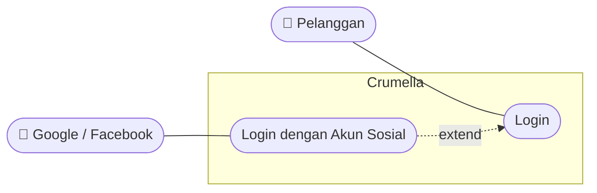

### Deskripsi Use Case

| Bagian | Keterangan |
|---|---|
| Aktor | Pelanggan, Google / Facebook |
| Prasyarat | Pelanggan berada di halaman Login dan memiliki akun Google atau Facebook |
| Layar Figma | Login (setelah teks "OR", dua tombol ikon Facebook dan Google) |
| Hasil Akhir | Pelanggan masuk ke sistem dan melihat Beranda |

### Alur Utama

1. Pelanggan menekan ikon **Facebook** atau **Google** di halaman Login.
2. Sistem meneruskan Pelanggan ke layanan yang dipilih untuk verifikasi akun.
3. Layanan Google/Facebook mengonfirmasi identitas Pelanggan.
4. Sistem mencocokkan atau membuat akun Pelanggan.
5. Sistem mengarahkan Pelanggan ke halaman Beranda.

### Alur Alternatif

- Verifikasi dibatalkan atau gagal: Pelanggan kembali ke halaman Login.

## 10. Use Case Melihat Beranda

### Pengertian

Use Case Melihat Beranda menggambarkan fitur ketika Pelanggan membuka halaman utama untuk melihat kategori dan menu populer.

### Diagram

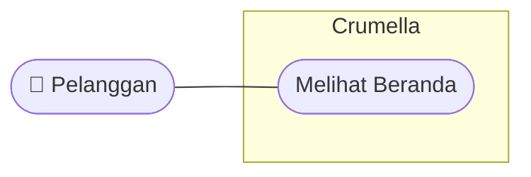

### Deskripsi Use Case

| Bagian | Keterangan |
|---|---|
| Aktor | Pelanggan |
| Prasyarat | Pelanggan sudah login |
| Layar Figma | Beranda |
| Hasil Akhir | Kategori, banner, dan Popular Menu tampil |

### Alur Utama

1. Pelanggan berhasil login atau menekan menu **Home** di navigasi bawah.
2. Sistem mengambil data kategori dan menu populer dari database.
3. Halaman Beranda menampilkan sapaan "Choose the Dessert you love", kolom pencarian, banner, deretan kategori, dan **Popular Menu**.
4. Dari Beranda, Pelanggan dapat menuju fitur lain melalui navigasi bawah (Home, Menu, Cart, Profile).

## 11. Use Case Mencari Dessert

### Pengertian

Use Case Mencari Dessert menggambarkan fitur ketika Pelanggan mencari dessert berdasarkan kata kunci.

### Diagram

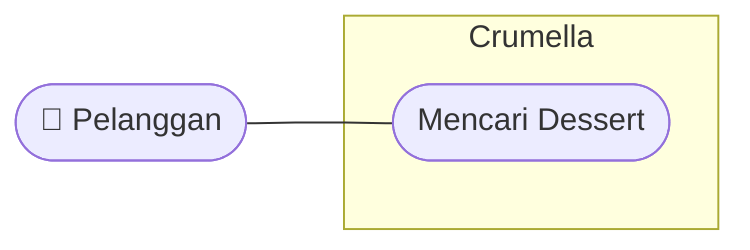

### Deskripsi Use Case

| Bagian | Keterangan |
|---|---|
| Aktor | Pelanggan |
| Prasyarat | Pelanggan sudah login |
| Layar Figma | Beranda ("Search for a dessert item") dan Menu ("Search for pastries") |
| Hasil Akhir | Dessert yang sesuai kata kunci ditampilkan |

### Alur Utama

1. Pelanggan menekan kolom pencarian di Beranda atau Menu.
2. Pelanggan mengetik kata kunci, misalnya "brownies".
3. Sistem mencari dessert yang sesuai melalui database.
4. Sistem menampilkan dessert yang ditemukan.

### Alur Alternatif

- Dessert tidak ditemukan: sistem menampilkan keterangan bahwa dessert tidak tersedia.

### Catatan

Halaman hasil pencarian belum digambar di Figma, sehingga bentuk tampilan hasil perlu diputuskan bersama.

## 12. Use Case Melihat Menu

### Pengertian

Use Case Melihat Menu menggambarkan fitur ketika Pelanggan membuka halaman Menu untuk menjelajahi dessert yang tersedia.

### Diagram

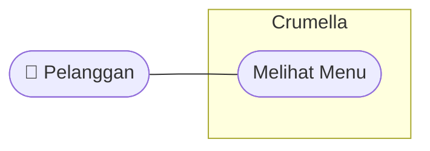

### Deskripsi Use Case

| Bagian | Keterangan |
|---|---|
| Aktor | Pelanggan |
| Prasyarat | Pelanggan sudah login |
| Layar Figma | Menu ("Explore our menu — Something sweet is waiting you") |
| Hasil Akhir | Daftar dessert tampil dalam grid dua kolom |

### Alur Utama

1. Pelanggan menekan menu **Menu** di navigasi bawah.
2. Sistem mengambil data dessert dari database.
3. Halaman Menu menampilkan kartu dessert dalam grid dua kolom.
4. Pelanggan menggulir halaman untuk menjelajahi dessert.

## 13. Use Case Melihat Detail Dessert

### Pengertian

Use Case Melihat Detail Dessert menggambarkan fitur ketika Pelanggan memilih satu dessert untuk melihat informasi lengkapnya.

### Diagram

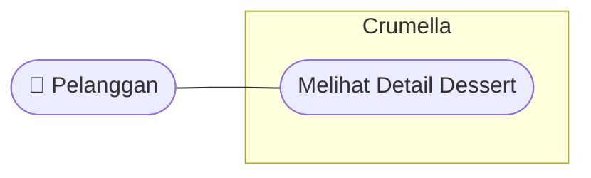

### Deskripsi Use Case

| Bagian | Keterangan |
|---|---|
| Aktor | Pelanggan |
| Prasyarat | Pelanggan sudah login dan berada di Beranda atau Menu |
| Layar Figma | Detail Dessert (contoh: Cloudy Choco Melt) |
| Hasil Akhir | Informasi lengkap dessert tampil |

### Alur Utama

1. Pelanggan menekan salah satu kartu dessert (di Popular Menu atau Menu).
2. Sistem mengambil data dessert dari database.
3. Halaman Detail menampilkan foto, nama, harga, rating dan jumlah review, deskripsi, pilihan ukuran (**Reguler** / **Large**), serta pengatur jumlah.
4. Dari halaman ini Pelanggan dapat menambah dessert ke keranjang atau menandainya sebagai favorit.
5. Pelanggan menekan tombol panah kembali untuk kembali ke halaman sebelumnya.

## 14. Use Case Menambah ke Keranjang

### Pengertian

Use Case Menambah ke Keranjang menggambarkan fitur ketika Pelanggan memilih ukuran dan jumlah dessert, lalu memasukkannya ke keranjang. Use case ini bersifat **extend** dari Melihat Detail Dessert.

### Diagram

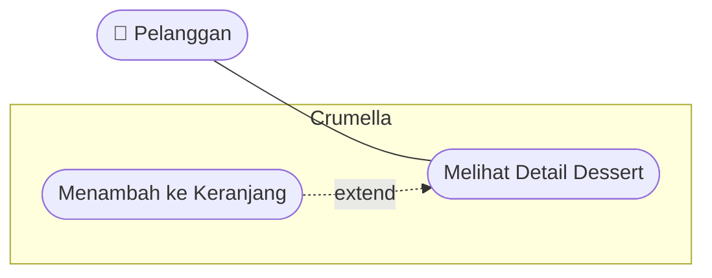

### Deskripsi Use Case

| Bagian | Keterangan |
|---|---|
| Aktor | Pelanggan |
| Prasyarat | Pelanggan sudah login dan berada di halaman Detail Dessert |
| Layar Figma | Detail Dessert (pilihan ukuran, pengatur jumlah, tombol di bagian bawah) |
| Hasil Akhir | Dessert beserta ukuran dan jumlahnya tersimpan di keranjang |

### Alur Utama

1. Pelanggan memilih ukuran **Reguler** atau **Large**.
2. Pelanggan mengatur jumlah dengan tombol **+** dan **−** (nilai awal 1).
3. Pelanggan menekan tombol besar di bagian bawah halaman.
4. Sistem memeriksa dan menyimpan data keranjang.
5. Sistem menampilkan konfirmasi bahwa dessert sudah masuk keranjang.

### Catatan

Tombol di bagian bawah halaman Detail pada Figma belum diberi label. Diasumsikan fungsinya adalah menambah ke keranjang.

## 15. Use Case Menandai Favorit

### Pengertian

Use Case Menandai Favorit menggambarkan fitur ketika Pelanggan menandai dessert yang disukai melalui ikon hati. Use case ini bersifat **extend** dari Melihat Detail Dessert.

### Diagram

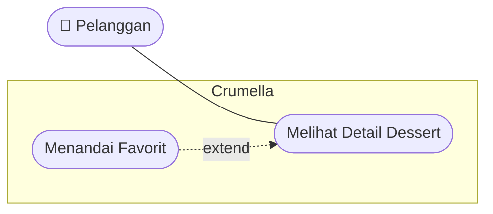

### Deskripsi Use Case

| Bagian | Keterangan |
|---|---|
| Aktor | Pelanggan |
| Prasyarat | Pelanggan sudah login dan melihat dessert |
| Layar Figma | Detail Dessert (ikon hati di sudut foto) dan Keranjang (ikon hati di tiap kartu) |
| Hasil Akhir | Dessert tersimpan sebagai favorit |

### Alur Utama

1. Pelanggan menekan ikon hati pada dessert.
2. Sistem menyimpan dessert tersebut ke daftar favorit Pelanggan.
3. Tampilan ikon hati berubah menandakan dessert sudah difavoritkan.

### Alur Alternatif

- Pelanggan menekan ikon hati yang sudah aktif: sistem menghapus dessert dari daftar favorit.

### Catatan

Menu **Favourites** di halaman Profil belum memiliki halaman tujuan, sehingga fitur melihat daftar favorit belum dimasukkan.

## 16. Use Case Melihat Keranjang

### Pengertian

Use Case Melihat Keranjang menggambarkan fitur ketika Pelanggan membuka keranjang untuk melihat dessert yang dipilih beserta rincian biayanya.

### Diagram

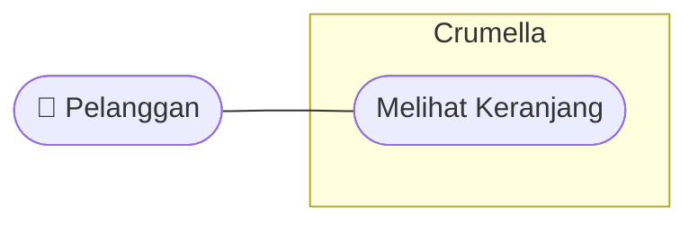

### Deskripsi Use Case

| Bagian | Keterangan |
|---|---|
| Aktor | Pelanggan |
| Prasyarat | Pelanggan sudah login |
| Layar Figma | Keranjang ("Your sweet cart") |
| Hasil Akhir | Daftar dessert dan rincian biaya tampil |

### Alur Utama

1. Pelanggan menekan menu **Cart** di navigasi bawah.
2. Sistem mengambil data keranjang dari database.
3. Halaman Keranjang menampilkan kartu dessert yang dipilih.
4. Sistem menampilkan rincian **Subtotal**, **Delivery**, dan **Total**.
5. Pelanggan dapat menekan ikon hati pada kartu untuk memfavoritkan dessert.
6. Pelanggan dapat menekan tombol **Checkout** untuk melanjutkan.

### Alur Alternatif

- Keranjang kosong: sistem menampilkan keterangan bahwa keranjang belum berisi dessert.

## 17. Use Case Checkout

### Pengertian

Use Case Checkout menggambarkan fitur ketika Pelanggan melanjutkan isi keranjang ke tahap pemesanan, memilih alamat dan metode pembayaran, lalu mengonfirmasi pesanan.

### Diagram

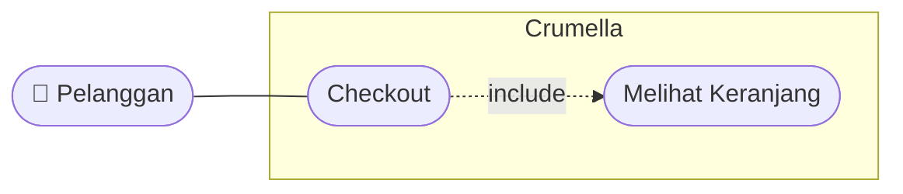

### Deskripsi Use Case

| Bagian | Keterangan |
|---|---|
| Aktor | Pelanggan |
| Prasyarat | Pelanggan sudah login dan keranjang berisi dessert |
| Layar Figma | Checkout |
| Hasil Akhir | Pesanan tersimpan dan terkonfirmasi |

### Alur Utama

1. Pelanggan menekan tombol **Checkout** di halaman Keranjang.
2. Sistem mengambil data dessert dari keranjang.
3. Halaman Checkout menampilkan **Shipping Address**, **Payment Method**, dan **Order Summary**.
4. Pelanggan memilih salah satu alamat pengiriman.
5. Pelanggan memilih salah satu metode pembayaran.
6. Pelanggan memeriksa ringkasan pesanan.
7. Pelanggan menekan tombol **Confirmation**.
8. Sistem menyimpan data pesanan ke database.

### Alur Alternatif

- Alamat atau metode pembayaran belum dipilih: sistem meminta Pelanggan melengkapinya.
- Pelanggan menekan panah kembali: Pelanggan kembali ke halaman Keranjang.

### Catatan

Nama metode pembayaran, isi alamat, dan halaman setelah **Confirmation** belum digambar di Figma. Hal ini perlu diputuskan bersama.

## 18. Use Case Melihat Profil

### Pengertian

Use Case Melihat Profil menggambarkan fitur ketika Pelanggan membuka halaman Profil untuk melihat identitas akun dan menu pengaturan.

### Diagram

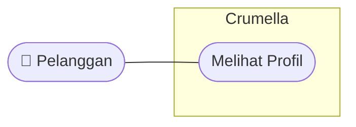

### Deskripsi Use Case

| Bagian | Keterangan |
|---|---|
| Aktor | Pelanggan |
| Prasyarat | Pelanggan sudah login |
| Layar Figma | Profil (2 varian) |
| Hasil Akhir | Foto, nama, dan menu profil tampil |

### Alur Utama

1. Pelanggan menekan menu **Profile** di navigasi bawah, atau menekan foto profil di Beranda.
2. Sistem mengambil data akun dari database.
3. Halaman Profil menampilkan foto, sapaan "Hi, Sweetie", nama pengguna, dan tombol **Edit Profile**.
4. Halaman Profil menampilkan daftar menu: Favourites, Downloads, Language, Location, Subscription, Clear Cache, Clear History, dan Log Out.

### Catatan

Menu Favourites, Downloads, Language, Location, Subscription, Clear Cache, dan Clear History belum memiliki halaman tujuan, sehingga belum dimasukkan sebagai use case.

## 19. Use Case Mengubah Profil

### Pengertian

Use Case Mengubah Profil menggambarkan fitur ketika Pelanggan memperbarui data akunnya.

### Diagram

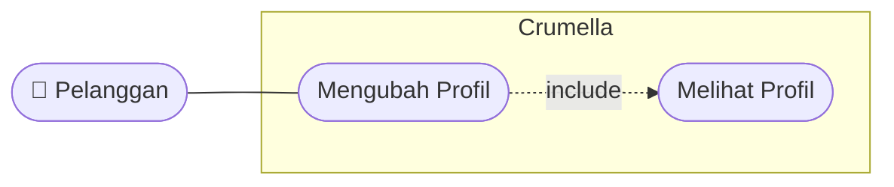

### Deskripsi Use Case

| Bagian | Keterangan |
|---|---|
| Aktor | Pelanggan |
| Prasyarat | Pelanggan sudah login dan berada di halaman Profil |
| Layar Figma | Edit Profil |
| Hasil Akhir | Data akun diperbarui |

### Alur Utama

1. Pelanggan menekan tombol **Edit Profile** di halaman Profil.
2. Sistem menampilkan form berisi **Name**, **E-mail address**, **User Name**, **Password**, dan **Phone number**.
3. Pelanggan mengubah data yang diinginkan. Kolom Password dapat ditampilkan atau disembunyikan dengan ikon mata.
4. Sistem memvalidasi data.
5. Sistem menyimpan perubahan ke database.

### Alur Alternatif

- Ada kolom yang kosong atau tidak valid: sistem menampilkan pesan kesalahan dan data tidak disimpan.
- Email atau username sudah dipakai akun lain: sistem menampilkan pesan kesalahan.

### Catatan

Tombol simpan belum digambar di halaman Edit Profil pada Figma. Perlu ditambahkan agar langkah 5 dapat dilakukan.

## 20. Use Case Keluar Akun

### Pengertian

Use Case Keluar Akun menggambarkan fitur ketika Pelanggan keluar dari akun Crumella.

### Diagram

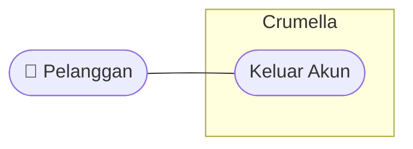

### Deskripsi Use Case

| Bagian | Keterangan |
|---|---|
| Aktor | Pelanggan |
| Prasyarat | Pelanggan sudah login |
| Layar Figma | Profil (menu **Log Out** dan tombol **Logout**) |
| Hasil Akhir | Sesi berakhir dan Pelanggan kembali ke halaman Login |

### Alur Utama

1. Pelanggan membuka halaman Profil.
2. Pelanggan menekan menu **Log Out** atau tombol **Logout**.
3. Sistem mengakhiri sesi Pelanggan.
4. Sistem mengarahkan Pelanggan ke halaman Login.

### Catatan

Di Figma terdapat dua pintu keluar (menu Log Out dan tombol Logout) yang fungsinya sama. Sebaiknya dipilih salah satu agar tidak membingungkan.

## 21. Hubungan Antar Use Case

| Hubungan | Jenis | Penjelasan |
|---|---|---|
| Login dengan Akun Sosial → Login | extend | Login lewat Google/Facebook adalah cara tambahan (opsional) selain email dan kata sandi |
| Menambah ke Keranjang → Melihat Detail Dessert | extend | Menambah ke keranjang hanya dilakukan jika Pelanggan memutuskan memesan dari halaman Detail |
| Menandai Favorit → Melihat Detail Dessert | extend | Menandai favorit adalah tindakan opsional saat melihat dessert |
| Checkout → Melihat Keranjang | include | Checkout selalu dimulai dari dan memakai isi keranjang |
| Mengubah Profil → Melihat Profil | include | Edit Profil selalu diakses dari halaman Profil |
| Syarat login | — | Use case 05 sampai 15 hanya dapat dilakukan setelah Login |
| Fitur sebelum login | — | Onboarding, Registrasi, dan Login dapat dibuka tanpa login |

## 22. Hal yang Belum Dimasukkan

Hal berikut ada di Figma, tetapi belum memiliki halaman atau penjelasan yang jelas, sehingga perlu diputuskan bersama sebelum ditambahkan:

1. Pemantauan pesanan ("Track your treat!" di Onboarding 3), belum ada halaman pelacakan.
2. Diskon pesanan pertama ("Get a sweet offer!" di Onboarding 2), belum ada halaman atau kolom voucher.
3. Ikon menu (tiga garis) di pojok kiri atas Beranda.
4. Kotak kategori di Beranda (belum berlabel dan belum ada halaman kategori).
5. Halaman hasil pencarian.
6. Menu Profil lainnya: Favourites, Downloads, Language, Location, Subscription, Clear Cache, dan Clear History.
7. Ikon terang/gelap di pojok kanan atas varian kedua halaman Profil.
8. Halaman setelah **Confirmation** (konfirmasi pesanan atau pembayaran).
9. Form Sign Up dan tombol simpan pada Edit Profil.

## 23. Catatan Perbaikan Teks pada Desain

Beberapa teks pada desain Figma perlu dirapikan sebelum masuk tahap pengkodean:

| Lokasi | Teks di Desain | Seharusnya |
|---|---|---|
| Onboarding 1 | Chosee your dessert! | Choose your dessert! |
| Onboarding 2 | prsanan; diskon special | pesanan; diskon spesial |
| Onboarding 3 | depan pint | depan pintu |
| Login | Paassword | Password |
| Login | Not Regisrated yet? | Not Registered yet? |
| Menu | waiting you | waiting for you |
| Detail Dessert | RP 20.0000 | Rp 20.000 |
| Detail Dessert | Select Sice; Reguler | Select Size; Regular |
| Checkout | Chekout; Shipping Adress; Order Sumarry | Checkout; Shipping Address; Order Summary |
| Profil | Clear Cashe | Clear Cache |
| Navigasi bawah | cart / Cart (tidak seragam) | Cart |

## 24. Kesimpulan

Use Case Diagram Crumella memiliki satu aktor utama, yaitu Pelanggan, satu aktor pendukung (Google / Facebook), dan 15 use case: Melihat Onboarding, Registrasi, Login, Login dengan Akun Sosial, Melihat Beranda, Mencari Dessert, Melihat Menu, Melihat Detail Dessert, Menambah ke Keranjang, Menandai Favorit, Melihat Keranjang, Checkout, Melihat Profil, Mengubah Profil, dan Keluar Akun.

Setiap use case dipetakan ke layar pada desain Figma. Dengan adanya Use Case Diagram ini, cakupan sistem lebih mudah dipahami oleh Kelompok 7 dan dapat menjadi acuan dalam pengembangan, pengujian, serta perbaikan Crumella.
