# PENJELASAN USE CASE DIAGRAM
## Website Crumella — Sistem Penjualan Cake & Dessert

## 1. Pendahuluan

Use Case Diagram adalah diagram yang menggambarkan siapa saja yang menggunakan sistem dan fitur apa saja yang dapat mereka lakukan.

Pada proyek Crumella, Use Case Diagram digunakan untuk menjelaskan fitur-fitur utama sistem penjualan cake dan dessert berbasis website, mulai dari registrasi dan login, mencari dan memilih produk, mengelola keranjang, checkout dan pembayaran, hingga pengelolaan produk dan pesanan oleh Admin. Seluruh isi dokumen ini disesuaikan dengan gambar **Use Case Diagram Website Crumella** (Kelompok 7, Sprint 1) yang memuat **3 aktor** dan **13 use case**.

## 2. Tujuan Use Case Diagram

1. Menggambarkan fitur-fitur yang tersedia pada website Crumella.
2. Menunjukkan siapa yang menggunakan setiap fitur.
3. Memastikan fitur yang dibuat sesuai dengan diagram dan tidak ada fitur tambahan di luar diagram.
4. Mempermudah anggota Kelompok 7 memahami cakupan sistem sebelum tahap pengkodean.
5. Menjadi acuan dalam pengembangan dan pengujian sistem pada Sprint berikutnya.

## 3. Aktor

| Aktor | Jenis | Penjelasan |
|---|---|---|
| Pelanggan | Aktor utama (primary) | Pengguna Crumella yang mendaftar, login, melihat dan mencari produk, mengelola keranjang, checkout, memantau status pesanan, dan mengelola profil. |
| Admin | Aktor sekunder (secondary) | Pengelola toko yang mengelola katalog produk serta memproses pesanan masuk. |
| Payment Gateway | Aktor eksternal (external) | Layanan pembayaran pihak ketiga (QRIS, E-Wallet, Bank) yang memverifikasi pembayaran saat Pelanggan memilih metode bayar. |

Payment Gateway hanya terlibat pada satu use case, yaitu Pilih Metode Pembayaran.

## 4. Use Case Diagram Keseluruhan

### Pengertian

Diagram ini menggambarkan seluruh fitur yang dapat dilakukan Pelanggan, Admin, dan Payment Gateway pada website Crumella dalam satu gambar.

### Diagram

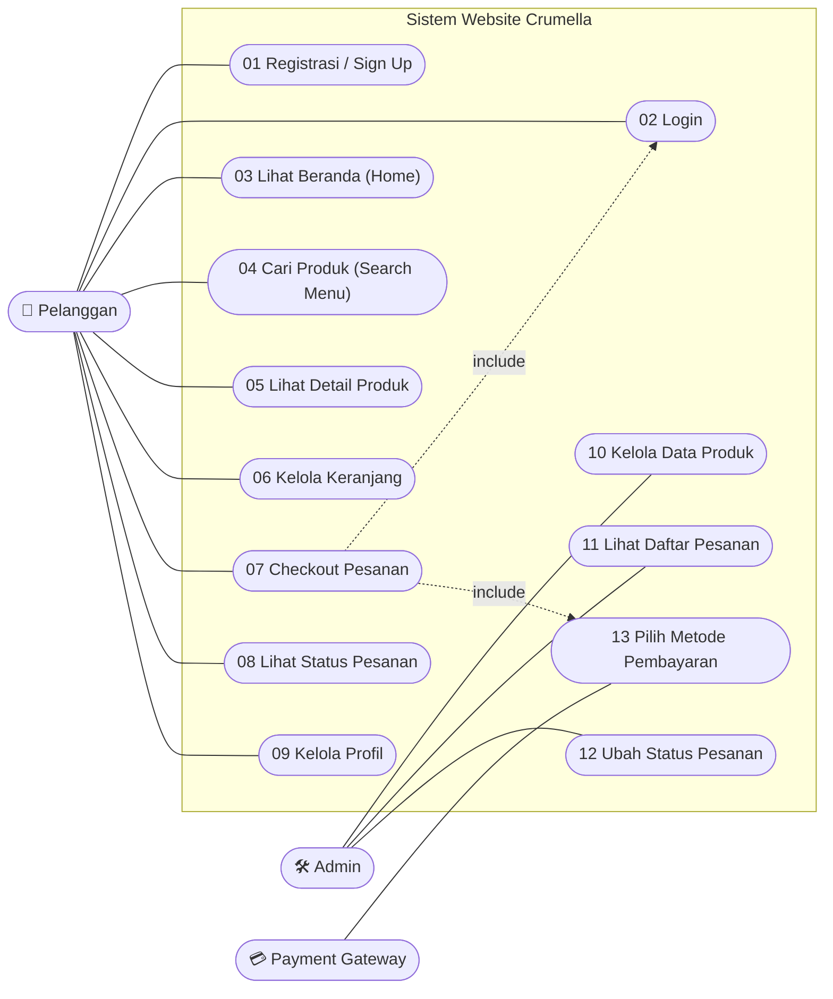

### Cara Membaca Diagram

1. **Pelanggan** adalah aktor utama, **Admin** aktor sekunder, dan **Payment Gateway** aktor eksternal.
2. **Kotak "Sistem Website Crumella"** adalah batas sistem. Semua use case berada di dalamnya.
3. **Oval** adalah satu fitur yang dapat dilakukan.
4. **Garis lurus** berarti aktor melakukan fitur tersebut secara langsung.
5. **Panah putus-putus include** berarti fitur tersebut selalu menjalankan fitur lain. Checkout Pesanan selalu menjalankan Login dan Pilih Metode Pembayaran.
6. **Kotak Peran Admin dan Catatan analisis** pada gambar adalah keterangan tambahan, bukan use case.

## 5. Alur Utama Pengguna (Charter)

Alur utama pengguna dari awal membuka website sampai pembayaran:

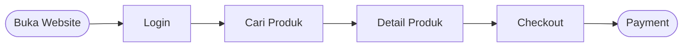

## 6. Daftar Use Case

| No | Use Case | Aktor | Penjelasan Singkat |
|---|---|---|---|
| 01 | Registrasi / Sign Up | Pelanggan | Membuat akun baru di website Crumella |
| 02 | Login | Pelanggan | Masuk ke sistem dengan email dan kata sandi |
| 03 | Lihat Beranda (Home) | Pelanggan | Melihat halaman utama website dan produk yang ditawarkan |
| 04 | Cari Produk (Search Menu) | Pelanggan | Mencari produk berdasarkan kata kunci |
| 05 | Lihat Detail Produk | Pelanggan | Melihat informasi lengkap satu produk |
| 06 | Kelola Keranjang | Pelanggan | Mengatur produk yang akan dipesan |
| 07 | Checkout Pesanan | Pelanggan | Melanjutkan isi keranjang menjadi pesanan; include Login dan Pilih Metode Pembayaran |
| 08 | Lihat Status Pesanan | Pelanggan | Memantau status pesanan yang sudah dibuat |
| 09 | Kelola Profil | Pelanggan | Melihat dan mengubah data akun |
| 10 | Kelola Data Produk | Admin | Mengelola katalog Dessert, Cake, Brownies, dan Minuman |
| 11 | Lihat Daftar Pesanan | Admin | Melihat pesanan masuk dari Pelanggan |
| 12 | Ubah Status Pesanan | Admin | Memperbarui status pesanan yang sedang diproses |
| 13 | Pilih Metode Pembayaran | Pelanggan, Payment Gateway | Memilih cara bayar dan memverifikasinya lewat Payment Gateway |

## 7. Use Case Registrasi / Sign Up

### Pengertian

Use Case Registrasi / Sign Up menggambarkan fitur ketika calon pelanggan membuat akun baru agar dapat berbelanja di website Crumella.

### Diagram

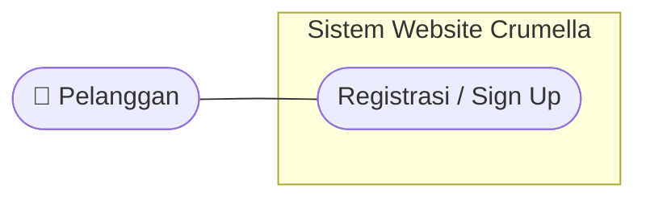

### Deskripsi Use Case

| Bagian | Keterangan |
|---|---|
| Aktor | Pelanggan |
| Prasyarat | Pelanggan belum memiliki akun |
| Hasil Akhir | Akun baru tersimpan dan Pelanggan dapat login |

### Alur Utama

1. Pelanggan membuka halaman Registrasi / Sign Up.
2. Pelanggan mengisi data akun (nama, email, dan kata sandi).
3. Sistem memvalidasi data dan memeriksa apakah email sudah terdaftar.
4. Sistem menyimpan akun baru ke database.
5. Sistem mengarahkan Pelanggan ke halaman Login.

### Alur Alternatif

- Email sudah terdaftar: sistem menampilkan pesan kesalahan dan akun tidak disimpan.
- Ada kolom yang kosong: sistem meminta Pelanggan melengkapi data.

### Catatan

Kolom data registrasi belum dirinci pada diagram. Kolom pada langkah 2 adalah usulan dan perlu dikonfirmasi bersama.

## 8. Use Case Login

### Pengertian

Use Case Login menggambarkan fitur ketika Pelanggan memasukkan email dan kata sandi untuk masuk ke Crumella. Use case ini juga selalu dijalankan oleh Checkout Pesanan (hubungan **include**), karena login wajib terverifikasi sebelum checkout dilanjutkan.

### Diagram

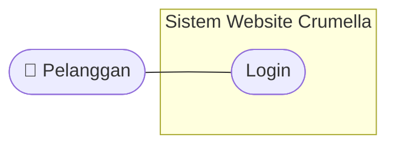

### Deskripsi Use Case

| Bagian | Keterangan |
|---|---|
| Aktor | Pelanggan |
| Prasyarat | Pelanggan sudah memiliki akun |
| Hasil Akhir | Pelanggan terverifikasi dan masuk ke sistem |

### Alur Utama

1. Pelanggan membuka halaman Login.
2. Pelanggan mengisi email dan kata sandi.
3. Pelanggan menekan tombol **Login**.
4. Sistem memeriksa data akun melalui database.
5. Sistem mengarahkan Pelanggan ke halaman Beranda (Home).

### Alur Alternatif

- Email atau kata sandi salah: sistem menampilkan pesan kesalahan dan Pelanggan tetap di halaman Login.
- Pelanggan belum punya akun: Pelanggan menuju Registrasi / Sign Up.

## 9. Use Case Lihat Beranda (Home)

### Pengertian

Use Case Lihat Beranda (Home) menggambarkan fitur ketika Pelanggan membuka halaman utama untuk melihat tampilan awal website dan produk cake dan dessert yang ditawarkan.

### Diagram

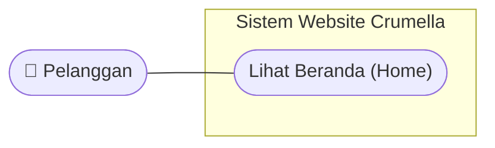

### Deskripsi Use Case

| Bagian | Keterangan |
|---|---|
| Aktor | Pelanggan |
| Prasyarat | Pelanggan sudah login |
| Hasil Akhir | Halaman utama beserta produk tampil |

### Alur Utama

1. Pelanggan berhasil login atau menekan menu **Home**.
2. Sistem mengambil data produk dari database.
3. Sistem menampilkan halaman Beranda berisi produk yang ditawarkan.
4. Dari Beranda, Pelanggan dapat menuju fitur lain seperti pencarian produk, keranjang, status pesanan, dan profil.

## 10. Use Case Cari Produk (Search Menu)

### Pengertian

Use Case Cari Produk (Search Menu) menggambarkan fitur ketika Pelanggan mencari produk cake, dessert, brownies, atau minuman berdasarkan kata kunci.

### Diagram

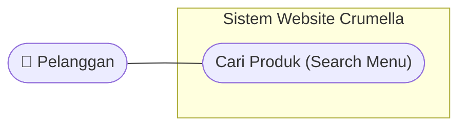

### Deskripsi Use Case

| Bagian | Keterangan |
|---|---|
| Aktor | Pelanggan |
| Prasyarat | Pelanggan sudah login |
| Hasil Akhir | Produk yang sesuai kata kunci ditampilkan |

### Alur Utama

1. Pelanggan menekan kolom pencarian.
2. Pelanggan mengetik kata kunci, misalnya "brownies".
3. Sistem mencari produk yang sesuai melalui database.
4. Sistem menampilkan produk yang ditemukan.

### Alur Alternatif

- Produk tidak ditemukan: sistem menampilkan keterangan bahwa produk tidak tersedia.

## 11. Use Case Lihat Detail Produk

### Pengertian

Use Case Lihat Detail Produk menggambarkan fitur ketika Pelanggan memilih satu produk untuk melihat informasi lengkapnya sebelum memutuskan memesan.

### Diagram

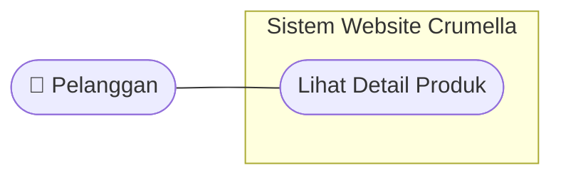

### Deskripsi Use Case

| Bagian | Keterangan |
|---|---|
| Aktor | Pelanggan |
| Prasyarat | Pelanggan sudah login dan berada di Beranda atau hasil pencarian |
| Hasil Akhir | Informasi lengkap produk tampil |

### Alur Utama

1. Pelanggan menekan salah satu produk.
2. Sistem mengambil data produk dari database.
3. Sistem menampilkan halaman detail berisi foto, nama, harga, dan deskripsi produk.
4. Dari halaman ini Pelanggan dapat memasukkan produk ke keranjang (Kelola Keranjang).

### Alur Alternatif

- Pelanggan menekan tombol kembali: sistem menampilkan halaman sebelumnya.

## 12. Use Case Kelola Keranjang

### Pengertian

Use Case Kelola Keranjang menggambarkan fitur ketika Pelanggan mengatur produk yang akan dipesan, mulai dari menambah produk, mengubah jumlah, hingga menghapus produk dari keranjang.

### Diagram

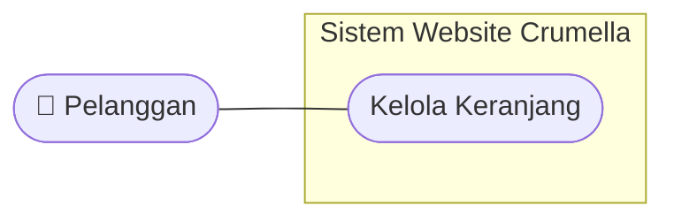

### Deskripsi Use Case

| Bagian | Keterangan |
|---|---|
| Aktor | Pelanggan |
| Prasyarat | Pelanggan sudah login |
| Hasil Akhir | Isi keranjang sesuai pilihan Pelanggan |

### Alur Utama

1. Pelanggan membuka halaman keranjang.
2. Sistem mengambil data keranjang dari database.
3. Sistem menampilkan produk terpilih beserta jumlah dan total harga.
4. Pelanggan menambah, mengubah jumlah, atau menghapus produk.
5. Sistem memperbarui isi keranjang dan total harga.
6. Pelanggan menekan **Checkout** untuk melanjutkan pesanan.

### Alur Alternatif

- Keranjang kosong: sistem menampilkan keterangan bahwa keranjang belum berisi produk.

### Catatan

Rincian tambah, ubah jumlah, dan hapus adalah asumsi dari kata "Kelola" pada diagram dan perlu dikonfirmasi.

## 13. Use Case Checkout Pesanan

### Pengertian

Use Case Checkout Pesanan menggambarkan fitur ketika Pelanggan melanjutkan isi keranjang ke tahap pemesanan. Use case ini memiliki dua hubungan **include**: ke **Login** (login wajib terverifikasi sebelum checkout dilanjutkan) dan ke **Pilih Metode Pembayaran** (checkout otomatis lanjut ke pilihan metode bayar).

### Diagram

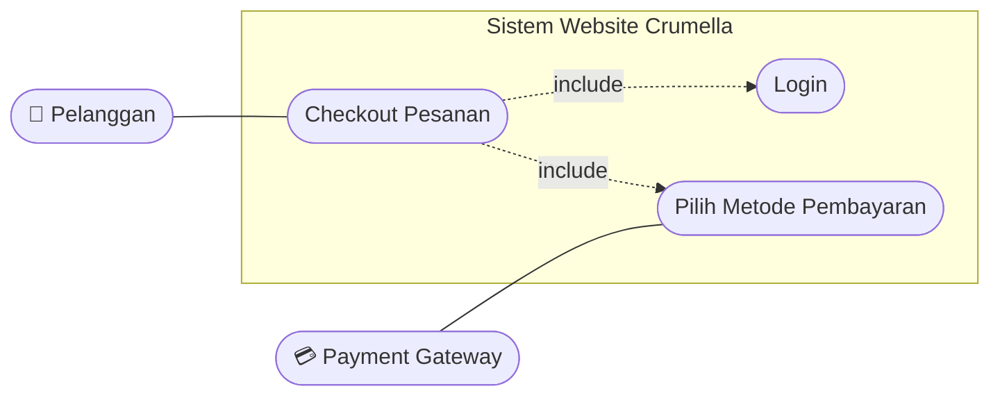

### Deskripsi Use Case

| Bagian | Keterangan |
|---|---|
| Aktor | Pelanggan |
| Prasyarat | Pelanggan memiliki produk di keranjang |
| Hasil Akhir | Pesanan tersimpan setelah pembayaran diverifikasi Payment Gateway |

### Alur Utama

1. Pelanggan menekan tombol **Checkout** di halaman keranjang.
2. Sistem menjalankan Login dan memastikan akun Pelanggan terverifikasi.
3. Sistem mengambil data produk dari keranjang dan menampilkan ringkasan pesanan.
4. Sistem otomatis melanjutkan ke Pilih Metode Pembayaran.
5. Pelanggan memilih metode bayar dan mengonfirmasi pesanan.
6. Payment Gateway memverifikasi pembayaran.
7. Sistem menyimpan data pesanan ke database.

### Alur Alternatif

- Pelanggan belum login atau belum terverifikasi: sistem mengarahkan Pelanggan ke Login.
- Keranjang kosong: checkout tidak dapat dilanjutkan.
- Pembayaran gagal atau dibatalkan: pesanan tidak diproses dan Pelanggan dapat memilih metode bayar lagi.

## 14. Use Case Lihat Status Pesanan

### Pengertian

Use Case Lihat Status Pesanan menggambarkan fitur ketika Pelanggan memantau perkembangan pesanan yang sudah dibuat. Status yang tampil adalah status yang diubah Admin melalui use case Ubah Status Pesanan.

### Diagram

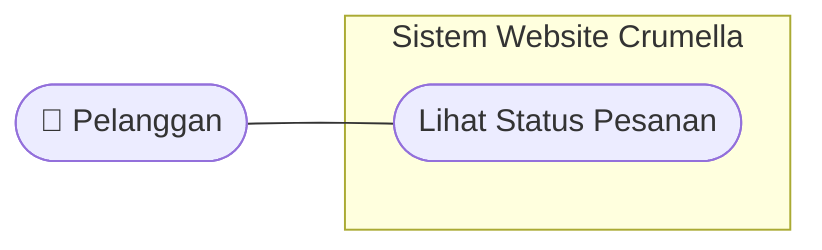

### Deskripsi Use Case

| Bagian | Keterangan |
|---|---|
| Aktor | Pelanggan |
| Prasyarat | Pelanggan sudah login dan sudah pernah membuat pesanan |
| Hasil Akhir | Status pesanan terbaru tampil |

### Alur Utama

1. Pelanggan membuka halaman status pesanan.
2. Sistem mengambil data pesanan milik Pelanggan dari database.
3. Sistem menampilkan daftar pesanan beserta statusnya.

### Alur Alternatif

- Belum ada pesanan: sistem menampilkan keterangan bahwa Pelanggan belum memiliki pesanan.

## 15. Use Case Kelola Profil

### Pengertian

Use Case Kelola Profil menggambarkan fitur ketika Pelanggan melihat dan memperbarui data akunnya.

### Diagram

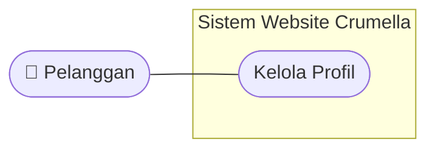

### Deskripsi Use Case

| Bagian | Keterangan |
|---|---|
| Aktor | Pelanggan |
| Prasyarat | Pelanggan sudah login |
| Hasil Akhir | Data akun tampil dan perubahan tersimpan |

### Alur Utama

1. Pelanggan membuka halaman profil.
2. Sistem mengambil data akun dari database dan menampilkannya.
3. Pelanggan mengubah data yang diinginkan.
4. Sistem memvalidasi data.
5. Sistem menyimpan perubahan ke database.

### Alur Alternatif

- Ada kolom yang kosong atau tidak valid: sistem menampilkan pesan kesalahan dan data tidak disimpan.
- Email sudah dipakai akun lain: sistem menampilkan pesan kesalahan.

### Catatan

Data profil yang dapat diubah belum dirinci pada diagram dan perlu dikonfirmasi.

## 16. Use Case Kelola Data Produk

### Pengertian

Use Case Kelola Data Produk menggambarkan fitur ketika Admin mengelola katalog produk Crumella yang terdiri dari kategori Dessert, Cake, Brownies, dan Minuman.

### Diagram

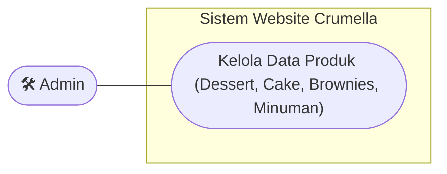

### Deskripsi Use Case

| Bagian | Keterangan |
|---|---|
| Aktor | Admin |
| Prasyarat | Admin sudah masuk ke sistem |
| Hasil Akhir | Katalog produk diperbarui dan tampil kepada Pelanggan |

### Alur Utama

1. Admin membuka halaman pengelolaan produk.
2. Sistem menampilkan daftar produk berdasarkan kategori.
3. Admin menambah, mengubah, atau menghapus data produk.
4. Sistem memvalidasi data.
5. Sistem menyimpan perubahan ke database.

### Alur Alternatif

- Data produk tidak lengkap atau tidak valid: sistem menampilkan pesan kesalahan dan data tidak disimpan.

### Catatan

Atribut produk (misalnya nama, harga, foto, dan deskripsi) belum dirinci pada diagram.

## 17. Use Case Lihat Daftar Pesanan

### Pengertian

Use Case Lihat Daftar Pesanan menggambarkan fitur ketika Admin melihat seluruh pesanan masuk dari Pelanggan.

### Diagram

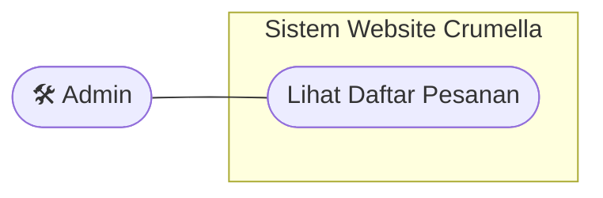

### Deskripsi Use Case

| Bagian | Keterangan |
|---|---|
| Aktor | Admin |
| Prasyarat | Admin sudah masuk ke sistem |
| Hasil Akhir | Daftar pesanan masuk tampil |

### Alur Utama

1. Admin membuka halaman daftar pesanan.
2. Sistem mengambil data pesanan dari database.
3. Sistem menampilkan daftar pesanan beserta statusnya.

### Alur Alternatif

- Belum ada pesanan masuk: sistem menampilkan keterangan bahwa daftar pesanan masih kosong.

## 18. Use Case Ubah Status Pesanan

### Pengertian

Use Case Ubah Status Pesanan menggambarkan fitur ketika Admin memperbarui status pesanan sesuai tahap pemrosesannya. Status baru dapat dilihat Pelanggan melalui Lihat Status Pesanan.

### Diagram

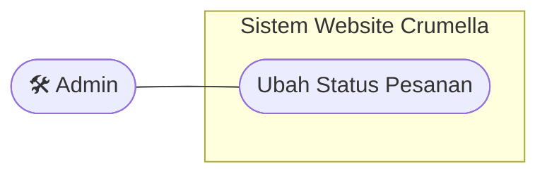

### Deskripsi Use Case

| Bagian | Keterangan |
|---|---|
| Aktor | Admin |
| Prasyarat | Admin sudah masuk ke sistem dan ada pesanan masuk |
| Hasil Akhir | Status pesanan diperbarui |

### Alur Utama

1. Admin membuka daftar pesanan.
2. Admin memilih pesanan yang akan diperbarui.
3. Admin memilih status baru untuk pesanan tersebut.
4. Sistem menyimpan status baru ke database.
5. Pelanggan dapat melihat status terbaru pada Lihat Status Pesanan.

### Alur Alternatif

- Penyimpanan gagal: sistem menampilkan pesan kesalahan dan status lama tetap berlaku.

### Catatan

Daftar status pesanan (misalnya diproses, dikirim, selesai) belum ditentukan dan perlu diputuskan bersama.

## 19. Use Case Pilih Metode Pembayaran

### Pengertian

Use Case Pilih Metode Pembayaran menggambarkan fitur ketika Pelanggan memilih cara membayar pesanan (QRIS, E-Wallet, atau Bank) dan pembayarannya diverifikasi oleh Payment Gateway. Use case ini dijalankan otomatis dari Checkout Pesanan (hubungan **include**).

### Diagram

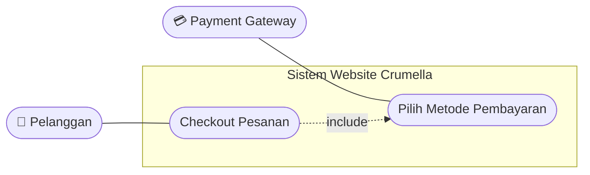

### Deskripsi Use Case

| Bagian | Keterangan |
|---|---|
| Aktor | Pelanggan, Payment Gateway |
| Prasyarat | Pelanggan sedang melakukan Checkout Pesanan |
| Hasil Akhir | Pembayaran terverifikasi oleh Payment Gateway |

### Alur Utama

1. Setelah checkout, sistem menampilkan pilihan metode pembayaran.
2. Pelanggan memilih salah satu metode: QRIS, E-Wallet, atau Bank.
3. Sistem meneruskan data pembayaran ke Payment Gateway.
4. Payment Gateway memproses dan memverifikasi pembayaran.
5. Payment Gateway mengirim hasil verifikasi ke sistem.
6. Sistem menyimpan hasil pembayaran dan melanjutkan pesanan.

### Alur Alternatif

- Pembayaran gagal atau waktu pembayaran habis: sistem menampilkan pesan dan Pelanggan dapat memilih metode bayar lagi.

### Catatan

Penyedia e-wallet dan bank yang didukung belum ditentukan.

## 20. Hubungan Antar Use Case

| Hubungan | Jenis | Penjelasan |
|---|---|---|
| Checkout Pesanan → Login | include | Login wajib terverifikasi sebelum checkout dilanjutkan |
| Checkout Pesanan → Pilih Metode Pembayaran | include | Checkout otomatis lanjut ke pilihan metode bayar, lalu diverifikasi Payment Gateway |
| Payment Gateway — Pilih Metode Pembayaran | asosiasi | Aktor eksternal yang memverifikasi pembayaran |
| Ubah Status Pesanan (Admin) dan Lihat Status Pesanan (Pelanggan) | — | Status yang diubah Admin menjadi status yang dilihat Pelanggan (keterkaitan data, bukan relasi pada diagram) |
| Peran Admin | — | Mengelola katalog dan memproses pesanan masuk (Kelola Data Produk, Lihat Daftar Pesanan, Ubah Status Pesanan) |

## 21. Catatan Analisis dan Hal yang Perlu Dikonfirmasi

### Catatan analisis pada diagram

- Login wajib terverifikasi sebelum checkout dilanjutkan.
- Checkout otomatis lanjut ke pilihan metode bayar, lalu diverifikasi Payment Gateway.

### Hal yang belum dijelaskan pada diagram

1. Kolom data pada Registrasi / Sign Up dan Kelola Profil.
2. Cara Admin masuk ke sistem. Diagram tidak menampilkan hubungan Admin dengan Login.
3. Atribut produk pada Kelola Data Produk dan daftar status pesanan pada Ubah Status Pesanan.
4. Rincian aksi pada Kelola Keranjang (tambah, ubah jumlah, hapus).
5. Penyedia e-wallet dan bank yang didukung oleh Payment Gateway.
6. Fitur yang belum ada pada diagram, misalnya keluar akun (logout), pembatalan pesanan, dan riwayat pembayaran.

## 22. Kesimpulan

Use Case Diagram Crumella memiliki satu aktor utama yaitu Pelanggan, satu aktor sekunder yaitu Admin, satu aktor eksternal yaitu Payment Gateway, dan 13 use case: Registrasi / Sign Up, Login, Lihat Beranda (Home), Cari Produk (Search Menu), Lihat Detail Produk, Kelola Keranjang, Checkout Pesanan, Lihat Status Pesanan, Kelola Profil, Kelola Data Produk, Lihat Daftar Pesanan, Ubah Status Pesanan, Pilih Metode Pembayaran.

Dengan adanya Use Case Diagram ini, cakupan sistem lebih mudah dipahami oleh Kelompok 7 dan dapat menjadi acuan dalam pengembangan, pengujian, serta perbaikan website Crumella.
